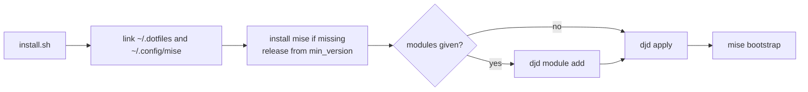
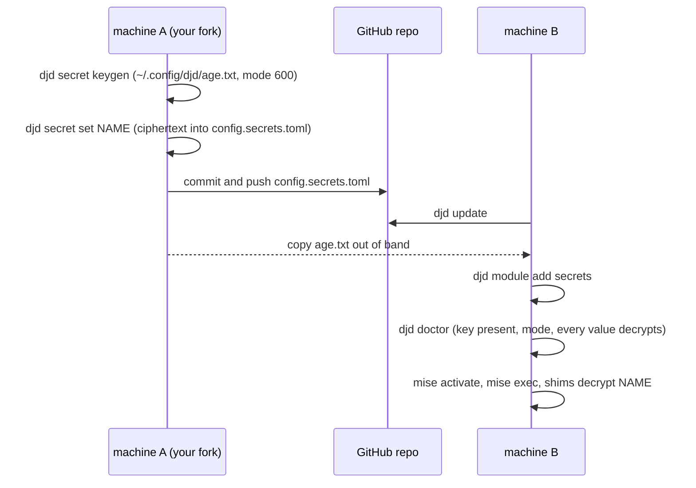

# Architecture

This page explains why the repository works the way it does. [reference.md](reference.md) holds the lookup tables, [ci.md](ci.md) describes the workflows, and [how-to.md](how-to.md) has the task guides.

These dotfiles bring an Ubuntu 26.04 machine on amd64 or arm64 to a known state. `mise bootstrap` does all of the work: system packages, system files, the firewall, dotfiles, the login shell, and tools. The repository is the global mise config, and `djd` is a thin command-line tool over mise tasks.

Four targets drive the design, smallest first.

1. The agent sandbox is a disposable Docker image or VM where coding agents run. The `agent` module builds it.
2. The server is a VM that you reach over ssh or mDNS, with ufw and docker. The `server` module builds it.
3. The desktop is XFCE over xrdp with Japanese input, in a VM or in the desktop image. The `desktop` module builds it.
4. agentOS is a [Rivet agentOS](https://rivet.dev/docs/agent-os) VM. It receives the portable subset of the dotfiles: `.profile`, the git config, and WASM registry tools.

## The checkout is the global mise config

`install.sh` links `~/.config/mise` to the `mise-config/` directory of the checkout, so mise reads the repository as its global config. The directory has that name because both `mise/` and `.config/mise/` would make mise treat the checkout itself as a project config.

## Dotfiles are one symlink per file

budybye/dotfiles deploys with chezmoi `mode = "symlink"`. This repository also uses symlinks, but through the `symlink-each` mode of mise. Every file becomes its own link, such as `~/.config/git/config` pointing to `~/.dotfiles/home/.config/git/config`, and every directory stays real.

Editing a deployed file edits the checkout. Programs that write next to their config, such as fcitx5, write into `~` and never into the repository. A symlink to a whole directory would let them write into the repository.

A program can still change a tracked file through its link. lazygit rewrites its config in place when it migrates renamed keys, and `git config --global` appends to `~/.config/git/config`. Both leave the checkout dirty. A program that saves through a temporary file and a rename, such as `sed -i`, replaces the link with a regular file. `mise dot status` then reports `exists but is not a symlink`, and `djd doctor` fails. `djd apply` moves the new file aside as `*.djd-backup-<time>` and links the repository file again. [How to keep an edit that a program made](how-to.md#keep-an-edit-that-a-program-made) shows how to save the edit first.

`~/.dotfiles` can itself be a symlink to a checkout elsewhere, because `install.sh` creates it. Moving the checkout then means relinking one path. The links stay absolute, which is the mise default, because `~` never moves on these machines.

## One install path covers three situations

`install.sh` runs the same steps whether you start from a checkout, from `curl | sh`, or inside the Docker build. From a checkout, it turns `~/.dotfiles` into a symlink to that checkout, but only when `~/.dotfiles` does not exist yet (a link that points nowhere counts as missing). When it exists, `install.sh` says so and applies the tree that is already there, not the checkout it runs from. From `curl | sh`, it clones into `~/.dotfiles`. In the Docker build, the image first copies `install.sh`, the `djd` wrapper and `mise-config/` to `~/.dotfiles`, and copies the full tree before its last pass. `install.sh` replaces a mise that is older than the `min_version` it reads.



The mise release has one source, the `min_version` line of `mise-config/config.toml`. `install.sh` reads it after it has linked or cloned the checkout, and only when mise is missing. `MISE_VERSION` overrides it. `lint:config` requires that `mise.toml` and every `jdx/mise-action` pin in the workflows name the same release. `install.sh` ends by running the `djd` wrapper, which owns `PATH`, the locale, and `MISE_ENV`, so a curl install and a later `djd apply` run in the same environment. [reference.md](reference.md#bootstrap-phases-and-hooks) lists what `mise bootstrap` does, in order.

`install.sh` clones and links by hand, although `mise bootstrap --from <url> --from-dir ~/.dotfiles --config-dir mise-config` does the same two steps. The repository does not use that command for two reasons. It bootstraps before `djd module add` has written the module selection. And a checkout that you use in place needs a symlink, not a clone.

## A module is a mise config environment

Each module is a file named `mise-config/config.<module>.toml`, which mise loads as a config environment. `djd module add` and `djd module remove` write the selection to `miserc.local.toml`, which git ignores. They write the modules in one canonical order, `agent server desktop full secrets`, so later modules win key collisions. A module declares its own dotfile group, so the group is active exactly when you select the module.

The `server` module owns the sshd hardening. Its `pre-dotfiles` hook fails an apply unless the drop-in `10-djd.conf` is in effect. The check lives in `hooks/sshd-keys-only`, which `djd doctor` runs too. It reads the setting without sudo from the `sshd_config` layout of Ubuntu and falls back to `sudo sshd -T`. After the drop-in changes, `server-pre-dotfiles` (not `sshd-keys-only`) reloads a running sshd once. The check also falls back to `sudo sshd -T` when a drop-in contains an `Include` or cannot be read by the user, because the greps cannot see those settings. On 26.04, sshd is socket-activated. `ssh.socket` stays active, and `ssh.service` stays idle until a connection arrives. [SECURITY.md](../SECURITY.md#server-module) lists the rest of the hardening.

sshd keeps the first value it reads, but a `Match` block overrides a global value for the users it matches. When any `Match` line exists in `sshd_config` or `sshd_config.d`, the hook therefore always takes the slow path and runs `sudo sshd -T -C user=<current user>,host=localhost,addr=203.0.113.1`. That catches `Match all` and `Match User <current user>`. It does not see a `Match` for another user or for an address, and it does not see a `Match` in a file outside those two paths. The check covers the current user's effective settings, not every possible login.

Shells and sandboxes default to `LANG=C.UTF-8`, so tool output stays English for agents. Only the `desktop` module switches the system locale to Japanese. A selection from your own `MISE_ENV` would replace the module selection, which is why the `djd` wrapper unsets it. [reference.md](reference.md#modules) describes the case of a project that uses mise environments itself.

## Everything outside the desktop module works headless

Everything outside the `desktop` module is CLI and must work headless. GUI content goes in two places. The first is the `desktop` module with its `desktop/` dotfile group. The second is the GUI packages of another module, gated with `env = "desktop"`:

```toml
"apt:libgtk-3-dev" = { version = "latest", env = "desktop" }
```

A headless `full` machine skips those packages, and adding `desktop` later installs them. `[tools]` has no env gating, so a GUI app that ships as a mise tool, such as sniffnet in `full`, installs everywhere. It is a single binary and does no harm on a headless machine. The sandbox image holds the CLI set, and the desktop image holds the GUI set.

## Hooks live in the module that needs them

mise runs the hooks of every selected module in order, base first, so two modules that declare the same hook both run it. [reference.md](reference.md#bootstrap-phases-and-hooks) holds the one table of parts and hooks. This section gives the reasons.

- Base declares `pre-user`. It switches the login shell through sudo, because the plain `chsh` that mise runs asks for a password that cloud users lack.
- Base, `agent`, `desktop`, and `server` each declare `pre-dotfiles`. The first three run `hooks/dotfile-conflicts` for their dotfile group and move a real file that a dotfile would replace aside. Symlink entries refuse real files, so something has to move them. It is a hook and not part of `djd apply`, because mise runs the hooks of a part only when that part runs, so `--dry-run`, `--skip dotfiles`, and a bootstrap that stops earlier leave your files alone. The hooks of all selected modules run in order, base first, so a failing `server` hook still comes after the base and `agent` hooks have moved files.
- The `server` module declares `post-packages`, which runs `hooks/server-post-packages`: it adds the user to the `docker` group, and it refuses the apply while sshd is still as it was. sshd is socket-activated, so the drop-in that the files part writes next turns passwords and root login off from the next connection, whether or not the rest of the apply succeeds. A user with no authorized key, a root apply, or an sshd on another port than the firewall's 22 would be locked out, so those three stop the apply first. Its `pre-dotfiles` hook runs `hooks/server-pre-dotfiles` after the files part wrote the sshd drop-in, because the drop-in must exist before the check.
- The `desktop` module declares `final`, which runs `hooks/desktop-final`. It purges the screen lockers and sets the xrdp security values after the packages exist. It makes no download. HackGen NF is the `http:hackgen` tool of the module, which mise downloads and checks against a pinned checksum.

mise has native `[bootstrap.users]` and `[bootstrap.groups]` tables, and a plan with them added the user to the `docker` group. They need a fixed user name, and OrbStack runs as the host user, so the hook stays.

## Removal uses mise, and tools track latest

The repository has no migrations framework. Machine tools have no lockfile. Only the dev tools of the repository are locked, in `mise.lock`.

Removing things uses mise itself: `mode = "absent"` entries, `mise bootstrap --prune-dotfiles`, and `djd module remove`. That command runs `mise bootstrap unapply` and then `mise dot unapply --group`, because the first skips dotfile groups. apt packages stay installed.

Tools track `latest` behind `minimum_release_age = "3d"`, so a release must be three days old before mise installs it. `pi` and `omp` are the exception (`minimum_release_age_excludes` in `config.agent.toml`): they release often, and new releases are wanted at once. The Docker image digest is the reproducible artifact. Add `lockfile = true` and run `mise lock --global` if your machines must match bit for bit. Add an Omarchy-style `migrations/` runner when a change needs imperative steps.

## djd forces the C.UTF-8 locale

`home/.local/bin/djd` runs `mise run djd:<cmd>` from `$HOME` with tool auto-install off. The djd tasks are plain bash, and installing tools belongs to `djd apply`. Running from `$HOME` keeps a `mise.toml` in the current directory out of `mise bootstrap`.

The wrapper forces `LC_ALL=C.UTF-8`, and `install.sh` gets the same value because it ends by running the wrapper. In mise 2026.10.23, a Japanese locale breaks the firewall check, because mise decides that ufw is active by matching the English line `Status: active`. Under a Japanese locale, `mise bootstrap` then reports firewall drift forever. The `desktop` module sets such a locale, and orb and ssh forward `LC_ALL`, which sudo keeps. On those machines, run raw `mise bootstrap` commands with `LC_ALL=C.UTF-8` until mise pins the locale itself.

`djd module` and `djd secret` declare their arguments as usage specs with `#USAGE`. Mise therefore rejects a bad action or module name before the script runs, and `djd module --help` and `djd secret --help` print the arguments. `djd apply`, `djd update` and `djd status` pass extra flags through to the mise command they run; `djd doctor` ignores them. `mise run lint` validates the specs with `mise-config` as the global config.

## Secrets use the age support of mise

mise has four secret features, and this repository uses one of them. budybye/dotfiles instead encrypts whole files, such as `.env` and SSH private keys, with a passphrase through chezmoi.

| mise feature | Fits here? |
| --- | --- |
| `[dotfiles]` `encrypt = true` | No. It works only with `mode = "track"`, which uses the history repository of mise. This repository deploys with symlinks. |
| `[dotfiles]` `mode = "fnox"` | No. [fnox](https://fnox.jdx.dev) 1.44 or newer is a separate tool. It keeps the encrypted file in its own global config on each machine, and `mise dot apply` writes the file into place. Nothing reaches the repository. |
| `[env]` age values, experimental | Yes. The `secrets` module uses it, and that module is the only one that sets `experimental = true`. |
| `[bootstrap.secrets]` | No. It supplies secret inputs to bootstrap templates from environment variables. |

The flow across two machines:



- `djd secret keygen` creates `~/.config/djd` with mode 700, writes the age identity with mode 600, and refuses to overwrite an existing key.
- `djd secret set NAME` prompts for a value and writes `NAME = { age = "..." }` into `mise-config/config.secrets.toml`. A name that exists is replaced in place. It passes `MISE_EXPERIMENTAL=1`, because mise marks age encryption experimental. Only ciphertext reaches the repository. An empty answer replaces an existing value with an empty one.
- The task is `raw=true`. Without it, mise stops feeding stdin to a task once the selected `secrets` module has values to redact. Every `djd secret set` after the first then stored an empty value and exited 0, and `djd doctor` still said ok, because an empty value decrypts. The sandbox test sets two values in a row with the module selected and reads both back.
- `djd module add secrets` makes the values visible to interactive shells through `mise activate`, to `mise exec` and `mise run`, and to every tool that starts through a mise shim. A program that a shimmed tool starts inherits them. `sh -c`, `bash -lc`, and `zsh -lc` do not see them, so `curl -H "...$TOKEN"` from `zsh -lc` sends an empty secret.
- A decrypted value goes through the `$VAR` and `{{ }}` expansion of mise. A value stored as `pw$HOME-end` comes back with `$HOME` replaced, and an undefined `${USER}` prints a mise warning on every call. Do not store a secret that contains `$` or `{{`. The investigation found no mise setting that turns the expansion off.
- The key at `~/.config/djd/age.txt` is the only identity that decrypts. `djd secret set` encrypts to that key alone, so an SSH key is never a recipient.
- `age.strict = false` is deliberate. With strict on and the module selected, a machine without the key fails every mise command, including `djd secret keygen`, `djd doctor`, `djd module remove secrets`, and every shim, so the machine cannot recover itself. With strict off, a machine without the key keeps working with the values unset. That setting also hides a wrong or unreadable key, so `djd doctor` runs `mise env` with `MISE_AGE_STRICT=true`. It fails when the secrets module is selected and the key is missing, has a group or other permission bit (0600 and 0400 pass), or cannot decrypt a value.
- One key serves all your machines. Copy `age.txt` to each one and keep an offline backup, for example in a password manager. If you lose every copy, the values are unrecoverable. mise has no rekey command, so adding a recipient means entering each value again.

Files such as SSH keys and `rclone.conf` stay out of the repository. You have three options. Put a secret from the file in the secrets module, copy the file by hand, or store the file with `fnox set --file`. For the last option, declare the file with `mode = "fnox"` in a local config.

## Shells share one .profile, and caches keep them fast

`~/.profile` is the file that every login shell and every interactive shell reaches. It stays POSIX and has no side effects. `sh -c` and a non-login `bash -c` do not read it. [reference.md](reference.md#shell-startup-files) lists which file each shell reads.

mise shims are on `PATH` from `.profile` and from `ENV PATH` in the images. Non-interactive agent shells such as `sh -c`, `bash -lc`, and `docker exec` therefore find every managed tool without `mise activate`. A shim costs about 50 ms per call, against 3 ms for the real binary. Interactive shells skip the shim, because `mise activate` puts the real tool directories first. Both numbers come from the sandbox image, measured in October 2026 on an arm64 Mac running OrbStack. The images also set `LANG=C.UTF-8`, because `docker run` and `docker exec` read no `~/.profile`. Without it, `tree` printed a Japanese file name as octal escapes in a plain `docker run` of the sandbox image.

The rc files cache the init script of each tool in `$XDG_CACHE_HOME/{zsh,bash}/init/` and write it atomically. `djd apply` clears the cache after bootstrap. Without the cache, an interactive zsh took 1.39 s to start. With the cache, it took 75 ms. Both numbers are hyperfine means of `zsh -i -c exit` in the sandbox image, measured in October 2026 on an arm64 Mac running OrbStack.

One init stays uncached. `mise activate` embeds the current `PATH` in its output, so a cached copy would reset `PATH` for later shells.

The zsh plugins are `[bootstrap.repos]` entries in `mise-config/config.toml`, cloned by `mise bootstrap` into `~/.local/share/zsh/plugins/<name>`. A default branch would put whatever it holds that day into shells that may see secrets, so every entry is pinned to a commit with `ref`. To update one, set a newer `ref`. A commit `ref` rules out `depth`, so the clones are full clones. `.zshrc` sources them through zsh-defer, and a missing checkout is skipped without a message. A first shell before the first bootstrap therefore loads no plugin and prints nothing. Plugin drift shows in `mise bootstrap status` and `djd doctor`. Replacing sheldon did not change the start time. The median of ten interactive starts was 102.5 ms before and after, measured in November 2026 in the sandbox container with a method that differs from the hyperfine runs above.

[SECURITY.md](../SECURITY.md#local-overrides) lists the machine-local overrides.

Aliases stay in `.functions`, not in the `[shell_alias]` table of mise. `[shell_alias]` works in bash, zsh, and fish, and a container run with `mise activate` confirmed it. It cannot keep the `command -v` guard that turns `ls` into `lsd` only when lsd exists. It cannot hold a function such as `ping()`. Because `.functions` runs after `mise activate`, a second definition there would win anyway. Moving the aliases would also give bash the `rm -i`, `cp -i`, and `mv -i` aliases that only zsh has today.

## Files follow XDG where the tool allows

`.profile` exports the four XDG variables with the defaults of the specification. The shell files keep history in `$XDG_STATE_HOME`, completion dumps and init scripts in `$XDG_CACHE_HOME`, and configuration in `$XDG_CONFIG_HOME`. Four files stay directly in `~`, because their programs read only that path: `.profile`, `.bash_profile`, `.bashrc`, and `.zshenv`. `.zshenv` then moves zsh to `ZDOTDIR`. The X session reads `~/.xsession`, which x11-common hard-codes.

The repository assumes the default locations. The dotfile deployment, the age key, and the git include path name `~/.config` directly. The `PATH` of the Dockerfile, the gh credential helper in the git config, and the `Exec` lines that the zed and zen `postinstall` scripts write name `~/.local/share/mise/shims` directly. Setting other XDG directories changes what shells and tools resolve themselves, and it would break those fixed paths.

Some programs still write into `~` or into their config directory, and the repository accepts that. Two reasons decide. A variable that `.profile` exports reaches login shells and not `docker exec`, so a tool would keep its state in two places. Some tools have no setting at all. npm and bun are the exception, because mise shims apply the `[env]` table of the `agent` module to every shell type, so those two follow XDG everywhere. gpg is not a mise tool, so it stays. [reference.md](reference.md#xdg-locations) lists what lands where.

## The desktop apps each carry a trust anchor

The `desktop` module requires four apps. A failed install fails `mise bootstrap`, and `tests/desktop-apps.sh` checks each app in the desktop image and in the VM test. The image test also starts Brave and Zen headless and opens a window for ghostty and Zed inside the RDP session. No app installs through `curl | sh`, which is how budybye/dotfiles installs Zen and Zed.

| App | Source | What proves the download |
| --- | --- | --- |
| ghostty | `apt:ghostty`, Ubuntu universe | The signed Ubuntu archive. |
| brave | `apt:brave-browser` from Brave's apt repository | The three signing-key fingerprints in `[bootstrap.apt.sources.brave-browser]`. mise keeps only those keys, and a changed key fails the apply. They match brave.com/signing-keys. |
| zed | mise `github:` tool | The asset digest, always, and the GitHub artifact attestation when the release has one. mise does not require one, so a release uploaded with a stolen maintainer token, which carries none, passes like Zen. |
| zen | mise `github:` tool | The asset digest that GitHub reports. Upstream publishes no signature and no attestation, so this shows that the download matches the release listing, not who built it. |

Brave's repository has no `resolute` suite, so the source sets `suites = "stable"`. Both `github:` tools track `latest` under the 3-day `minimum_release_age`, so mise skips the newest Zen release for three days. mise has no registry entry for either app, and a templated `asset_pattern` made `mise lock` record the aarch64 asset for linux-x64, so each tool names its asset per platform. Zed and Zen ship no menu entry that survives an upgrade. Each `postinstall` writes one with `Exec` on the mise shim and regenerates it on every install.

Brave aborts inside a container unless it runs with `--no-sandbox`, because Docker's default seccomp policy blocks namespace creation (tested on OrbStack in November 2026). The flag also switches off Brave's renderer seccomp-bpf sandbox. The Dockerfile adds it to a user-level copy of the menu entry, and the module does not, so a VM keeps Brave's sandbox. The image test starts Brave through that entry, and with the system entry instead Brave aborts with `Failed to move to new namespace`. A seccomp profile that allows user namespaces would keep Brave's sandbox on without `SYS_ADMIN`, but it applies only to containers started with it, so `docker run` of the published image would still abort. The repository ships none, and no one has run Brave under one. [SECURITY.md](../SECURITY.md#desktop-module) states the trade.

Zed and Zen each carry an in-app updater that would replace files in the mise install directory without mise's digest check and without the release age. `ZED_UPDATE_EXPLANATION` in the module's `[env]` makes Zed skip its update poll, and the Zen `postinstall` writes `distribution/policies.json` with `DisableAppUpdate` and `DisableTelemetry`. A headless screenshot of Zen's `about:policies` listed both as active (November 2026). Updates go through `mise upgrade`. mise also puts a tool's own bin directories ahead of `PATH` while a `postinstall` runs, so both scripts reset `PATH` to `/usr/bin:/bin`, and `filter_bins` limits what each tool puts on `PATH`.

HackGen NF has no Ubuntu package and no GitHub asset digest, so it is the `http:hackgen` tool of the module with a pinned version and SHA-256. Its `postinstall` resets `PATH` for the same reason, copies the four `.ttf` files to `~/.local/share/fonts/HackGen`, and runs `fc-cache`. A copy survives the next upgrade, which deletes the versioned install directory. The install fails without `fc-cache`. The module declares no `fontconfig` package, so it relies on a dependency of its desktop packages (inference, not checked). A wrong checksum fails the install with the expected and the actual value.

## The RDP service is TLS only and keeps the other xrdp defaults

The desktop image and the `desktop` module set `security_layer=tls` and `AllowRootLogin=false`, and `djd doctor` and the image test check both. The values are the hardening that this repository chose. The rest of the xrdp defaults stay as the package ships them, and some are weak. [reference.md](reference.md#rdp-security-and-known-limits) lists the probe results and the open limits, and [SECURITY.md](../SECURITY.md#known-limits-of-the-rdp-service) summarizes them.

Two facts explain the settings. `security_layer=hybrid` is not a valid value in this xrdp. The string `security_layer=%s is not recognized, will use security_layer=negotiate` is in `libxrdp.so`, so a typo or an upgrade to `hybrid` silently re-enables the legacy RDP layer. And this xrdp has no NLA at all, so the choice is TLS or negotiate, not TLS or NLA.

## agentOS runs a subset

agentOS guests are WASM processes with a virtual filesystem and the brush shell. They run no Linux ELF binaries, no mise, no zsh, and no system services. The export therefore carries only the portable subset, and `agentos/boot.mjs` is the one place that declares it.

- **Files.** `FILES` maps guest paths to five repository files: `.profile`, the three git files, and `agentos/gitconfig`. `tests/agentos-bundle.sh` lists the same five with their content, so a new entry fails CI until someone reviews it there. The reader compares the real path of each file with its own path under the real repository root, which rejects a tracked symlink and a symlinked parent directory. Nothing checks hard links, because git cannot store them. `FILES` is a constant, so nothing a user supplies reaches the reader.
- **Tools.** `SOFTWARE` maps each registry package to the command it must put on the guest's `PATH`. The offline test runs `command -v` for each command in the sandbox image. An agent therefore never finds a command in a guest that the sandbox image lacks. The same name does not mean the same program. The registry `jq` is jaq.
- **Pin.** `agentos/software.lock.json` holds the release and, per registry package, the URL and sha256 of the file the registry served when someone last ran `mise run agentos:lock`. The export carries those `{url, digest}` entries in `bundle.json` under `software`, next to `files`. The boot gives the VM the same entries, so the sidecar downloads exactly those URLs and rejects any other bytes. Nothing compares the live registry at boot, so the boot installs the locked bytes whatever the registry serves now. The export and the boot check the lock against `SOFTWARE` and `package.json` offline. A bump of `@rivet-dev/agentos-core` fails both until the lock is refreshed. The `AGENTOS_SOFTWARE_REGISTRY_URL` guard applies to `agentos:lock` only, because only the lock reads a registry.
- **Git.** The shared git config names delta and gh, and the guest has neither. It also lacks `less`, git's default pager. `agentos/gitconfig` becomes `~/.gitconfig`, which git reads after `~/.config/git/config`. It sets the pager to `cat`, empties the diff filter, and resets the credential helpers. The shared file stays unchanged, because Ubuntu machines have those tools. The export sets no `environment`, so the guest keeps the `PAGER` of agentos-core, which is `less`, and only git is covered by the file.
- **Shell.** brush says `[ -r <missing file> ]` is true, so `.profile` tests `profile.local` with `-f`. One boot check sources `.profile` alone and requires exit 0 and an empty stderr. The earlier check compared only stdout, so a `.profile` that printed an error and returned 1 in every guest still passed.
- **Permissions.** The boot denies the guest network. The default policy lets the guest resolve model-provider hosts such as api.anthropic.com. A boot check fetches that host and passes only when curl fails with `Could not resolve host`, which is what distinguishes the denied policy from the default one. The check cannot tell the two apart on an offline host. Package downloads run on the host, so the denial costs nothing.

`mise run agentos:export` writes the bundle. `mise run agentos:boot` builds the same bundle in memory, boots a VM with it through `@rivet-dev/agentos-core` 0.4.6, and asserts the result. [reference.md](reference.md#agentos) lists what works and what does not.

## Docker images are one Dockerfile in two passes

`.devcontainer/Dockerfile` builds every flavor from `ubuntu:26.04`. A flavor is a set of modules, passed as `DJD_MODULES`. The Dockerfile runs `install.sh` as `ubuntu` in two passes, and the first pass is two `RUN`s.

| `RUN` of `install.sh` | Sees | `DJD_BOOTSTRAP_FLAGS` | Token | Why |
| --- | --- | --- | --- | --- |
| First, pass one | `install.sh`, the `djd` wrapper, `mise-config/` | `--skip tools,dotfiles` | none | The maintainer scripts of apt packages, and the `apt-get purge` of the desktop final hook, run in the environment of the mise process, so they must not see the token. |
| Second, pass one | the same files | `--only tools` | BuildKit secret `github_token`, as `MISE_GITHUB_TOKEN` | Only tools reach GitHub. |
| Last, pass two, after `COPY . ~/.dotfiles` | the full tree | `--only dotfiles` | none | An edit to dotfiles, docs, or tests then reuses the slow layers from the build cache. |

A rebuild after a docs-only change took 2 s in the sandbox image, measured in October 2026 on an arm64 Mac running OrbStack. The split images have the same package and tool lists as the single-`RUN` images, compared by hash on both flavors, and the desktop image is 5 MB larger. The first `COPY` brings the `djd` wrapper along, because `install.sh` ends by running it.

The image environment is `DEBIAN_FRONTEND=noninteractive`, `DJD_NO_MUX=1`, and `LANG=C.UTF-8`, then `PATH` with the mise shims, and `DJD_REVISION` last, so a new commit never invalidates the cached layers. `DJD_NO_MUX` stops `.zprofile` from starting herdr in every `docker run -it` shell. `LANG` is set because `docker run` and `docker exec` read no `~/.profile`. The desktop session is meant to keep `ja_JP.UTF-8`, which PAM reads from `/etc/default/locale`, and the image test asserts it. When this page was written, that assertion had not run against a built image, and whether PAM's value wins over the container's `LANG` is an inference. [reference.md](reference.md#docker-images) lists the images.

## CI mirrors local tasks, and releases are safe to repeat

Every CI job runs the mise task that you run locally, so a green CI run and a green `make` run mean the same thing. Each task declares the tools it needs, so a job installs only those. [ci.md](ci.md) lists the jobs.

Five decisions shape the workflows.

- CI skips a change that touches only `docs/**`, Markdown files or `llms.txt`, except `DESIGN.md` and `agent/**`, because the two `agent/**/AGENTS.md` files ship in the images and `lint` checks `DESIGN.md`. A docs-only push therefore never releases. `docs.yaml` runs `lint:docs` on those pushes and on their pull requests (and on `DESIGN.md` changes, which also run CI), so the link and reference check no longer waits for the next code push.
- `tag.yaml` tags a commit only when that commit contains the newest `X.Y.Z` tag, and only the newest release moves the floating tags. A re-run of an older CI run, or a slower older release, then cannot move `latest` backward.
- A re-run of CI for a commit that already has a release publishes nothing, so a fixed tag `X.Y.Z` is not rebuilt with today's `latest` tools. Only a new release dispatches `push.yaml`.
- `tag.yaml` waits for the `push.yaml` run it dispatched and fails with it. A tag push by the `GITHUB_TOKEN` starts no workflow, and `push.yaml` runs as the bot, so nobody would be notified of a failed publish. The `tag.yaml` run belongs to the person whose push produced the release.
- Release builds use no build cache, so a published image cannot reuse a cache entry that another workflow wrote. `push.yaml` then smoke-tests each pushed image by digest with `djd doctor`, because the published bytes are rebuilt and can differ from the image that CI tested. A red smoke test stops the merge job, so no floating tag moves.

GitHub documents private as the default visibility of a new GHCR package. The first release of this repository came out public, and an anonymous `docker manifest inspect` resolved every tag. After the first release of a fork, check the visibility. [How to publish the first release](how-to.md#publish-the-first-release) shows how.

## Where the rest lives

[history.md](history.md) compares the repository with budybye/dotfiles, tells where it came from, and lists planned work.
