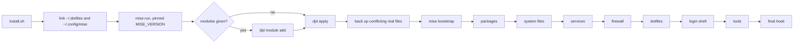

# Architecture

This page explains why the repository works the way it does. [reference.md](reference.md) holds the lookup tables, [ci.md](ci.md) describes the workflows, and [how-to.md](how-to.md) has the task guides.

These dotfiles bring an Ubuntu 26.04 machine on amd64 or arm64 to a known state. `mise bootstrap` does all of the work: system packages, system files, the firewall, dotfiles, the login shell, and tools. The repository is the global mise config, and `djd` is a thin command-line tool over mise tasks.

Four targets drive the design, smallest first.

1. The agent sandbox is a disposable Docker image or VM where coding agents run. The `agent` module builds it.
2. The server is a VM that you reach over ssh or mDNS, with ufw and docker. The `server` module builds it.
3. The desktop is XFCE over xrdp with Japanese input, in a VM or in the desktop image. The `desktop` module builds it.
4. agentOS is a [Rivet agentOS](https://rivet.dev/docs/agent-os) VM. It receives the portable subset of the dotfiles: `.profile`, the git config, and WASM registry tools.

## The checkout is the global mise config

`install.sh` links `~/.config/mise` to the `mise-config/` directory of the checkout, so mise reads the repository as its global config. The directory has that name because both `mise/` and `.config/mise/` would make mise treat the checkout itself as a project config.

## Dotfiles are one symlink per file

budybye/dotfiles deploys with chezmoi `mode = "symlink"`. This repository also uses symlinks, but through the `symlink-each` mode of mise. Every file becomes its own link, such as `~/.config/git/config` pointing to `~/.dotfiles/home/.config/git/config`, and every directory stays real.

Editing a deployed file edits the checkout. Programs that write next to their config, such as fcitx5 and sheldon, write into `~` and never into the repository. A symlink to a whole directory would let them write into the repository.

A program can still change a tracked file through its link. lazygit rewrites its config in place when it migrates renamed keys, and `git config --global` appends to `~/.config/git/config`. Both leave the checkout dirty. A program that saves through a temporary file and a rename, such as `sed -i`, replaces the link with a regular file. `mise dot status` then reports `exists but is not a symlink`, and `djd doctor` fails. `djd apply` moves the new file aside as `*.djd-backup-<time>` and links the repository file again. [How to keep an edit that a program made](how-to.md#keep-an-edit-that-a-program-made) shows how to save the edit first.

`~/.dotfiles` can itself be a symlink to a checkout elsewhere, because `install.sh` creates it. Moving the checkout then means relinking one path. The links stay absolute, which is the mise default, because `~` never moves on these machines.

## One install path covers three situations

`install.sh` runs the same steps whether you start from a checkout, from `curl | sh`, or inside the Docker build. From a checkout, it turns `~/.dotfiles` into a symlink to that checkout. From `curl | sh`, it clones into `~/.dotfiles`. In the Docker build, the image copies the repository to `~/.dotfiles` first.



`install.sh` clones and links by hand, although `mise bootstrap --from <url> --from-dir ~/.dotfiles --config-dir mise-config` does the same two steps. The repository does not use that command for two reasons. It bootstraps before `djd module add` has written the module selection. And a checkout that you use in place needs a symlink, not a clone.

## A module is a mise config environment

Each module is a file named `mise-config/config.<module>.toml`, which mise loads as a config environment. `djd module add` and `djd module remove` write the selection to `miserc.local.toml`, which git ignores. They write the modules in one canonical order, `agent server desktop full secrets`, so later modules win key collisions. A module declares its own dotfile group, so the group is active exactly when you select the module.

The `server` module owns the sshd hardening. Its `pre-dotfiles` hook fails an apply unless the drop-in `10-djd.conf` is in effect. The hook reads the setting without sudo from the `sshd_config` layout of Ubuntu and falls back to `sudo sshd -T`. After the drop-in changes, the hook reloads a running sshd once. On 26.04, sshd is socket-activated. `ssh.socket` stays active, and `ssh.service` stays idle until a connection arrives. [SECURITY.md](../SECURITY.md#server-module) lists the rest of the hardening.

Shells and sandboxes default to `LANG=C.UTF-8`, so tool output stays English for agents. Only the `desktop` module switches the system locale to Japanese.

## Everything outside the desktop module works headless

Everything outside the `desktop` module is CLI and must work headless. GUI content goes in two places. The first is the `desktop` module with its `desktop/` dotfile group. The second is the GUI packages of another module, gated with `env = "desktop"`:

```toml
"apt:libgtk-3-dev" = { version = "latest", env = "desktop" }
```

A headless `full` machine skips those packages, and adding `desktop` later installs them. `[tools]` has no env gating, so a GUI app that ships as a mise tool, such as sniffnet in `full`, installs everywhere. It is a single binary and does no harm on a headless machine. The sandbox image holds the CLI set, and the desktop image holds the GUI set.

## Hooks live in the module that needs them

mise runs the hooks of every selected module in order, base first, so two modules could declare the same phase and both hooks would run. Each phase key is declared once today.

- Base declares `pre-user`. It switches the login shell through sudo, because the plain `chsh` that mise runs asks for a password that cloud users lack.
- The `server` module declares `post-packages`, which adds the user to the `docker` group. It also declares `pre-dotfiles`, which runs `hooks/server-pre-dotfiles` after the files phase wrote the sshd drop-in.
- The `desktop` module declares `final`, which runs `hooks/desktop-final`.

mise has native `[bootstrap.users]` and `[bootstrap.groups]` tables, and a plan with them added the user to the `docker` group. They need a fixed user name, and OrbStack runs as the host user, so the hook stays.

## Removal uses mise, and tools track latest

The repository has no migrations framework. Machine tools have no lockfile. Only the dev tools of the repository are locked, in `mise.lock`.

Removing things uses mise itself: `mode = "absent"` entries, `mise bootstrap --prune-dotfiles`, and `djd module remove`. That command runs `mise bootstrap unapply` and then `mise dot unapply --group`, because the first skips dotfile groups. apt packages stay installed.

Tools track `latest` behind `minimum_release_age = "3d"`, so a release must be three days old before mise installs it. The Docker image digest is the reproducible artifact. Add `lockfile = true` and run `mise lock --global` if your machines must match bit for bit. Add an Omarchy-style `migrations/` runner when a change needs imperative steps.

## djd forces the C.UTF-8 locale

`home/.local/bin/djd` runs `mise run djd:<cmd>` from `$HOME` with tool auto-install off. The djd tasks are plain bash, and installing tools belongs to `djd apply`. Running from `$HOME` keeps a `mise.toml` in the current directory out of `mise bootstrap`.

`djd` and `install.sh` also force `LC_ALL=C.UTF-8`. In mise 2026.10.23, a Japanese locale breaks the firewall check, because mise decides that ufw is active by matching the English line `Status: active`. Under a Japanese locale, `mise bootstrap` then reports firewall drift forever. The `desktop` module sets such a locale, and orb and ssh forward `LC_ALL`, which sudo keeps. On those machines, run raw `mise bootstrap` commands with `LC_ALL=C.UTF-8` until mise pins the locale itself.

`djd module` and `djd secret` declare their arguments as usage specs with `#USAGE`. Mise therefore rejects a bad action or module name before the script runs, and `djd module --help` and `djd secret --help` print the arguments. The other commands pass extra flags through to the mise command they run. `mise run lint` validates the specs with `mise-config` as the global config.

## Secrets use the age support of mise

mise has four secret features, and this repository uses one of them. budybye/dotfiles instead encrypts whole files, such as `.env` and SSH private keys, with a passphrase through chezmoi.

| mise feature | Fits here? |
| --- | --- |
| `[dotfiles]` `encrypt = true` | No. It works only with `mode = "track"`, which uses the history repository of mise. This repository deploys with symlinks. |
| `[dotfiles]` `mode = "fnox"` | No. [fnox](https://fnox.jdx.dev) 1.44 or newer is a separate tool. It keeps the encrypted file in its own global config on each machine, and `mise dot apply` writes the file into place. Nothing reaches the repository. |
| `[env]` age values, experimental | Yes. The `secrets` module uses it, and that module is the only one that sets `experimental = true`. |
| `[bootstrap.secrets]` | No. It supplies secret inputs to bootstrap templates from environment variables. |

The workflow has five parts.

- `djd secret keygen` writes an age identity to `~/.config/djd/age.txt` with mode 600, outside the repository. It creates `~/.config/djd` with mode 700 and refuses to overwrite an existing key.
- `djd secret set NAME` prompts for a value and appends `NAME = { age = "..." }` to `mise-config/config.secrets.toml`. It passes `MISE_EXPERIMENTAL=1`, because mise marks age encryption experimental. Only ciphertext reaches the repository.
- `djd module add secrets` makes the values visible to interactive shells through `mise activate`, to `mise exec` and `mise run`, and to every tool that starts through a mise shim. A plain `sh -c` does not see them.
- The key at `~/.config/djd/age.txt` is the only identity that decrypts. `djd secret set` encrypts to that key alone, so an SSH key is never a recipient. A machine without the key keeps working with the values unset, because `age.strict = false`. That setting also hides a wrong or unreadable key, so `djd doctor` fails when the secrets module is selected and the key is missing, is not mode 600, or cannot decrypt a value.
- One key serves all your machines. Copy `age.txt` to each one and keep an offline backup, for example in a password manager. If you lose every copy, the values are unrecoverable.

Files such as SSH keys and `rclone.conf` stay out of the repository. You have three options. Put a secret from the file in the secrets module, copy the file by hand, or store the file with `fnox set --file`. For the last option, declare the file with `mode = "fnox"` in a local config.

## Shells share one .profile, and caches keep them fast

`~/.profile` is the file that every login shell and every interactive shell reaches. It stays POSIX and has no side effects. `sh -c` and a non-login `bash -c` do not read it. [reference.md](reference.md#shell-startup-files) lists which file each shell reads.

mise shims are on `PATH` from `.profile` and from `ENV PATH` in the images. Non-interactive agent shells such as `sh -c`, `bash -lc`, and `docker exec` therefore find every managed tool without `mise activate`. A shim costs about 50 ms per call, against 3 ms for the real binary. Interactive shells skip the shim, because `mise activate` puts the real tool directories first. Both numbers come from the sandbox image, measured in October 2026 on an arm64 Mac running OrbStack.

The rc files cache the init script of each tool in `$XDG_CACHE_HOME/{zsh,bash}/init/` and write it atomically. `djd apply` clears the cache after bootstrap. Without the cache, an interactive zsh took 1.39 s to start. With the cache, it took 75 ms. Both numbers are hyperfine means of `zsh -i -c exit` in the sandbox image, measured in October 2026 on an arm64 Mac running OrbStack.

Two inits stay uncached. `mise activate` embeds the current `PATH` in its output, so a cached copy would reset `PATH` for later shells. `sheldon source` follows edits to `plugins.toml`. Every sheldon plugin is pinned to a commit with `rev`, and the header of `home/.config/sheldon/plugins.toml` explains how to bump one.

[SECURITY.md](../SECURITY.md#local-overrides) lists the machine-local overrides.

Aliases stay in `.functions`, not in the `[shell_alias]` table of mise. `[shell_alias]` works in bash, zsh, and fish, and a container run with `mise activate` confirmed it. It cannot keep the `command -v` guard that turns `ls` into `lsd` only when lsd exists. It cannot hold a function such as `ping()`. Because `.functions` runs after `mise activate`, a second definition there would win anyway. Moving the aliases would also give bash the `rm -i`, `cp -i`, and `mv -i` aliases that only zsh has today.

## Files follow XDG where the tool allows

`.profile` exports the four XDG variables with the defaults of the specification. The shell files keep history in `$XDG_STATE_HOME`, completion dumps and init scripts in `$XDG_CACHE_HOME`, and configuration in `$XDG_CONFIG_HOME`. Four files stay directly in `~`, because their programs read only that path: `.profile`, `.bash_profile`, `.bashrc`, and `.zshenv`. `.zshenv` then moves zsh to `ZDOTDIR`. The X session reads `~/.xsession`, which x11-common hard-codes.

The repository assumes the default locations. The dotfile deployment, the age key, the git include path, and the `PATH` of the Dockerfile name `~/.config` directly. Setting other XDG directories changes only what shells and tools resolve themselves.

Some programs still write into `~` or into their config directory, and the repository accepts that. Two reasons decide. A variable that `.profile` exports reaches login shells and not `docker exec`, so a tool would keep its state in two places. Some tools have no setting at all. npm and bun are the exception, because mise shims apply the `[env]` table of the `agent` module to every shell type, so those two follow XDG everywhere. gpg is not a mise tool, so it stays. [reference.md](reference.md#xdg-locations) lists what lands where.

## agentOS runs a subset

agentOS guests are WASM processes with a virtual filesystem and the brush shell. They run no Linux ELF binaries, no mise, no zsh, and no system services. The export therefore carries only the portable subset: `.profile`, the git config, and the registry WASM tools.

`mise run agentos:export` writes the bundle. `mise run agentos:boot` builds the same bundle in memory, boots a VM with it through `@rivet-dev/agentos-core` 0.4.6, and asserts the result. [reference.md](reference.md#agentos) lists what works and what does not.

## Docker images are one Dockerfile in two passes

`.devcontainer/Dockerfile` builds every flavor from `ubuntu:26.04`. A flavor is a set of modules, passed as `DJD_MODULES`. The Dockerfile runs `install.sh` as `ubuntu` in two passes.

The first pass sees only `install.sh` and `mise-config/`. It installs the packages and tools of `$DJD_MODULES` with `--skip dotfiles`. The second pass runs after `COPY . ~/.dotfiles` with `--only dotfiles`. An edit to dotfiles, docs, or tests then reuses the slow layer from the build cache. A rebuild after a docs-only change took 2 s in the sandbox image, measured in October 2026 on an arm64 Mac running OrbStack. [reference.md](reference.md#docker-images) lists the images.

## CI mirrors local tasks, and releases are safe to repeat

Every CI job runs the mise task that you run locally, so a green CI run and a green `make` run mean the same thing. Each task declares the tools it needs, so a job installs only those. [ci.md](ci.md) lists the jobs.

Three decisions shape the release chain.

- CI skips a change that touches only `docs/**` or Markdown files, except `DESIGN.md`. A docs-only push therefore never releases. The cost is that the Markdown link check in `lint` does not run on such a push.
- `tag.yaml` tags a commit only when that commit contains the newest `X.Y.Z` tag, and only the newest release moves the floating tags. A re-run of an older CI run, or a slower older release, then cannot move `latest` backward.
- Release builds use no build cache, so a published image cannot reuse a cache entry that another workflow wrote.

GitHub documents private as the default visibility of a new GHCR package. The first release of this repository came out public, and an anonymous `docker manifest inspect` resolved every tag. After the first release of a fork, check the visibility. [How to publish the first release](how-to.md#publish-the-first-release) shows how.

## Where the rest lives

[history.md](history.md) compares the repository with budybye/dotfiles, tells where it came from, and lists planned work.
