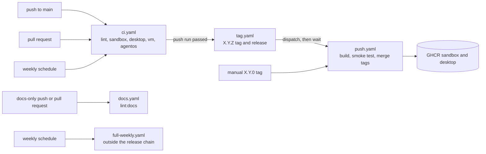

# CI and release reference

Facts about the GitHub Actions workflows, the tests they run, and the release chain. [architecture.md](architecture.md#ci-mirrors-local-tasks-and-releases-are-safe-to-repeat) explains the decisions behind them, and [how-to.md](how-to.md) has the procedures.

## Workflows

| File | Runs on | Permissions | Does |
| --- | --- | --- | --- |
| `ci.yaml` | Pushes to `main`, pull requests, a weekly schedule, and `workflow_dispatch` | `contents: read` | Runs the jobs below. |
| `docs.yaml` | Pushes to `main` and pull requests that touch `docs/**`, `**/*.md`, or `llms.txt`, except `agent/**` | `contents: read` | Runs `mise run lint:docs`. It reads the whole git history, so it checks out with `fetch-depth: 0`, and it installs no tools. It never releases. |
| `tag.yaml` | A completed `ci.yaml` run on `main` | none at the top. The job has `contents: write`, `actions: write`, and `checks: read`. | Tags and releases a commit that passed, dispatches `push.yaml`, and waits for it. |
| `push.yaml` | A semver tag push, or a dispatch by `tag.yaml` | none at the top. `build-images` has `contents: read` and `packages: write`, and `merge` has `packages: write`. | Publishes the images to GHCR. |
| `full-weekly.yaml` | A weekly schedule and `workflow_dispatch` | `contents: read` | Builds the `full` image, runs `djd doctor` in it, then runs `djd update` and `djd doctor` in it. It sits outside the release chain, so a red run never blocks a release. |

`ci.yaml` skips a push or pull request that touches only `docs/**` or Markdown files, except `DESIGN.md` and `agent/**`. The two `agent/**/AGENTS.md` files ship in the images and the sandbox test compares them, so a change there runs CI, tags, and releases. `docs.yaml` takes the other side of that filter, so a docs-only change still gets `lint:docs`, which checks links, anchors, repo paths, commands, `DJD_` variables, and the test list.

The weekly schedule catches upstream breakage, because tools track `latest`. Scheduled runs never release, because `tag.yaml` accepts push runs only. Each event has its own concurrency group, so a scheduled run never cancels the push run that a release waits for.

GitHub disables scheduled workflows in a public repository after 60 days without repository activity. That stops the weekly `ci.yaml` run and `full-weekly.yaml` without a message. Enable them again in the Actions tab.

## CI and release chain



## Timeouts

| Job | Timeout | Measured |
| --- | --- | --- |
| `ci.yaml` `lint` | 15 min | 22 s |
| `ci.yaml` `sandbox` | 25 min | 158 s on amd64, 129 s on arm64 |
| `ci.yaml` `desktop` | 25 min | 353 s on amd64, 294 s on arm64 |
| `ci.yaml` `vm` | 25 min | 200 s on amd64, 166 s on arm64 |
| `ci.yaml` `agentos` | 30 min | 21 s |
| `docs.yaml` | 10 min | not measured |
| `push.yaml` `build-images` | 45 min | 2 to 5 min |
| `push.yaml` `merge` | 10 min | not measured |
| `tag.yaml` release job | 60 min | about 6 min, because it waits for `push.yaml` |
| `full-weekly.yaml` | 60 min | about 21 min |

The measured values are medians of recent runs, read from the run history up to 1 November 2026. A timeout covers the slowest expected case with room, and it also limits how long a hung job holds its token. `full-weekly.yaml` prints `df -h /` first, because its one red run died with `No space left on device` and left no log.

## Jobs in ci.yaml

Every job runs a mise task that you can run locally. `make <task>` runs `mise run <task>`.

### lint

`mise run lint` runs six checks in parallel. Each check installs only its own tools. `lint` has no body of its own. It depends on the six `lint:*` tasks.

- `lint:shell` runs shellcheck and `shfmt -i 4` over every file whose first line is a `sh` or `bash` shebang, plus `home/.profile`, `.bash_profile`, and `.bashrc`, and `zsh -n` on each zsh startup file separately. It does not lint the inline `postinstall` scripts in the TOML files. When `shfmt` finds a difference, it prints `lint: shell is not formatted; run mise run lint:fix`.
- `lint:config` runs `mise fmt` and `mise tasks validate`. It also requires that the `min_version` line of `mise.toml`, the `min_version` line of `mise-config/config.toml`, and every `jdx/mise-action` step (an unquoted `version:` line) name the same mise release, because no bot bumps them. `install.sh` is not a pin, because it reads `min_version`. The check fails and names the source when a pin is missing or reformatted.
- `lint:workflows` runs jactionlint over the workflows and `dependabot.yml`, compares the runner labels with `.actrc`, and runs hadolint.
- `lint:design` lints `DESIGN.md`.
- `lint:docs` runs the checks in the next list, and also runs alone in `docs.yaml`.
- `lint:secrets` runs gitleaks over the whole git history. When there is no git directory, it runs over the files, so the secret scan never skips.

`lint:fix` rewrites shell and mise TOML formatting.

`lint:docs` needs only bash, takes 10 to 20 s, and checks that:

- Relative Markdown links and anchors resolve, `llms.txt` included. It ignores headings inside code fences.
- Every repo path in an inline code span exists. A leading `./` is allowed, and a path under a top-level name that existed in the git history but not now is reported. Without a git history, as in the docker lint run, only today's names count.
- Every `mise run` and `djd` command in a span names a real task or command, and every word after `make` does.
- Every `DJD_` variable in the docs appears in the code.
- Every `DJD_` variable in the code appears in some doc. `DJD_BAD` and `DJD_CHECK` (secret names that `test` makes up) and `DJD_COMMANDS` (a Makefile variable) are exempt.
- Every `tests/*.sh` is named in `docs/reference.md` and is run by a task under `mise-tasks/`. A bare name inside a quoted or space-delimited list counts as a reference, so a test with a common word for a name could pass trivially.

### sandbox, on amd64 and arm64

The `test` task builds the sandbox image and then runs these steps in order. Each step uses a throwaway container of the image, and the test checks exit statuses, not only output.

| # | Step | Must hold |
| --- | --- | --- |
| 1 | Offline tests | `mise run test:offline` passes (see the test map below). |
| 2 | Doctor | `djd doctor` passes. |
| 3 | Tools on `PATH` | A plain `docker run` finds `rg` without a login shell. |
| 4 | `.profile` | `~/.profile` alone puts the shims on `PATH`, tested with `env -i`. |
| 5 | Agent module | A shimmed `node` sees `PI_TELEMETRY=0` and `DO_NOT_TRACK=1` without a login shell. `~/.pi/agent/AGENTS.md` is a link, and its content equals `~/.omp/agent/AGENTS.md`. |
| 6 | Silent shells | Interactive zsh and bash start silently on a tty. The first zsh start fills the init cache, so the test drops its output. The second zsh start and a bash start must print nothing. |
| 7 | Login banner | `zsh -lc` output contains no `.zlogin` banner. With the banner tools stubbed to print distinct text, a login shell prints exactly the two banners and the `.zlogout` farewell. |
| 8 | Doctor, release and shell | `djd doctor` fails for an `os-release` that is not Ubuntu 26.04 and for a login shell that is not zsh, and passes again after each repair. |
| 9 | Doctor, sshd | The scenarios in the stub table below. |
| 10 | Doctor, xrdp | The xrdp scenarios in the stub table below. |
| 11 | Backup and relink | One container backs up a conflicting file, relinks a moved checkout through `install.sh`, and converges (next list). |
| 12 | Status | `djd status` exits 0 and prints the revision, which the image carries because it has no `.git`. |
| 13 | Secrets | A secrets round trip works (the list after the stub table). |

Step 11 in detail:

- `djd apply --dry-run` leaves a conflicting file in place and creates no backup.
- A real apply moves the file aside.
- A successful apply clears the zsh and bash init caches.
- Converging means that `djd doctor` and `mise bootstrap plan --detailed-exitcode` both pass.

`djd doctor` must exit non-zero and name the check for each of these stubs, in a throwaway container:

| Stub | Doctor must report |
| --- | --- |
| `os-release` with another `VERSION_ID`, or with `ID=debian` | `FAIL ubuntu` |
| the login shell set to bash | `FAIL login-shell` |
| the stock sshd layout with `10-djd.conf` | `ok sshd` |
| `Match all` with `PasswordAuthentication yes`, where the sshd stub honors `-C` and the hook has to pass it | `FAIL sshd` |
| `Match User nobody` with `X11Forwarding no` | `ok sshd` |
| an earlier drop-in that turns passwords on | `FAIL sshd` |
| an earlier drop-in that changes nothing | `ok sshd` |
| an `sshd_config` that does not start with the `Include`, with a stub that reports passwords on | `FAIL sshd` |
| the same file, with a stub that reports passwords off | `ok sshd` |
| `security_layer=negotiate` in `xrdp.ini` | `FAIL xrdp-tls`, and `ok xrdp-root-login` |
| `security_layer=tls` only as a comment | `FAIL xrdp-tls` |
| `AllowRootLogin=true` in `sesman.ini` | `FAIL xrdp-root-login`, and `ok xrdp-tls` |
| a real file in place of a dotfile | `FAIL dotfiles`, and the output lists the file |

The real hook cannot see a `Match` for another user or for an address, so the test stops at `Match all` and a harmless `Match`. A real sshd evaluates `Match` blocks only with `-C`, which is why the stub does the same.

The secrets round trip, step 13:

- The key has mode 600 and its directory mode 700, and `djd secret keygen` refuses to overwrite it.
- The module is selected before the first `djd secret set`. Two values are set in a row, and both decrypt through `mise exec`, because a task without `raw=true` stored an empty second value.
- The ciphertext lands in `config.secrets.toml` without the plaintext.
- `djd secret set NAME=value` exits 2 and writes nothing.
- `djd doctor` reports the secrets module as ok, then as failed for a missing key, for a different key, and for a key with any group or other bit (0400 and 0600 pass).

### desktop, on amd64 and arm64

The `test:desktop` task builds the desktop image and starts a server container, plus a control container of the same image with `security_layer=negotiate` and `AllowRootLogin=true`. The client is an `ubuntu:26.04` container with `freerdp3-x11`, `xvfb`, and `procps`, installed before the clock starts. The first login gets 120 s. The test runs these stages in order.

| # | Stage | Must hold | Why |
| --- | --- | --- | --- |
| 1 | RDP login | An xfreerdp client logs in and XFCE starts through `~/.xsession`. The environment of `xfce4-session`, read as its owner, has `GTK_IM_MODULE=fcitx`, `QT_IM_MODULE=fcitx`, `XMODIFIERS=@im=fcitx`, and `LANG=ja_JP.UTF-8`. | `.xsession` exports the fcitx variables. The system locale comes from PAM and `/etc/default/locale`, and it has to win over the `LANG=C.UTF-8` of the container. Root cannot read another user's `/proc/PID/environ` in a container, so the owner does. When this page was written, the `LANG` assertion had not run against a built image. |
| 2 | TLS key | The fingerprints of the server, the control, and the certificate that the image was built with all differ. | Every container would otherwise share one key, and anyone who pulls the image holds it. |
| 3 | Legacy layer | `xfreerdp3 /sec:rdp`, logged in as a throwaway account `probe`, is refused by the server. Its `xrdp.log` says `requested [RDP], selected []`, no `probe` session starts, and the first session stays up. The control accepts the same client (`selected [RDP]`, and the client stays connected). | Without the control, a client that cannot speak the legacy layer would pass the refusal on any server. The second account shows that a wrongly accepted client would start a session of its own. |
| 4 | Root login | Root gets a password in both containers. The control starts a root `xfce4-session`. The sesman log of the server says `ROOT login attempted, but root login is disabled`, and no root session starts. | The refused client stays at the login screen, so its exit code cannot show a refused root login. |
| 5 | Audio defaults | `pactl get-default-sink` prints `xrdp-sink` and `pactl get-default-source` prints `xrdp-source`. Then the test kills wireplumber, and a new wireplumber process must appear within 30 s with the same two defaults. | This shows that `~/.xsession` started PipeWire and that the autostart entry of `pipewire-module-xrdp` loaded both devices and made them the defaults through `pactl`. The source check matters, because the container has only one sink and wireplumber would pick it without the script. The defaults live in the metadata of wireplumber. The client has no audio device and plays nothing, so the test proves the setup and not the sound. |
| 6 | Apps | `tests/desktop-apps.sh` runs as the desktop user with `DJD_APPS_LAUNCH=1`. For each of brave-browser, ghostty, zen, and zed, the command resolves and prints its version, and the menu entry exists with an `Exec` that resolves. Brave runs that `Exec` line, which carries `--no-sandbox` in the image, plus `--headless=new --dump-dom about:blank`, and the output contains `<html`. Zen runs `--headless --screenshot` and writes a PNG. Ghostty and Zed start inside the RDP session, and each shows a window of its own `WM_CLASS` within 30 s. The test logs how long each took. | The VM test runs the same script without the variable. |
| 7 | Supervisor | `tests/xsession-audio.sh` runs as the desktop user. | See the list below the table. |
| 8 | Logout | The test ends `xfce4-session`, which also ends the session bus. No `pipewire`, `pipewire-pulse`, or `wireplumber` of the user remains after 30 s. A second login gets the same two audio defaults from daemons with new PIDs. | Before `~/.xsession` ended what it started, the daemons outlived the logout, and the supervisor started a `wireplumber` against the dead bus. |
| 9 | Container restart | The test restarts the server container, logs in again, and repeats the sink and source checks. | A restart leaves the stale PipeWire socket of the first session in `/run`, and `~/.xsession` must not take it for a live server. The client disconnects first, because it could otherwise reconnect and make the wait pass on its session. |

`tests/xsession-audio.sh` runs the real `~/.xsession` against stub daemons, and the sandbox test runs it too, in about 35 s. It checks that:

- The desktop starts without waiting for a server that is still starting.
- wireplumber starts after the server answers and again after it dies.
- A wireplumber that keeps dying is given up on after five quick runs, while a 30 s run resets the count.
- A server that never answers prints one line and starts nothing.
- A server that stops answering gets no new wireplumber.
- A server that already answers is left alone.
- Nothing the script started outlives the desktop.

It needs Linux, because it finds leftovers through `/proc`.

### vm, on amd64 and arm64

The `test:vm` task starts a fresh Ubuntu 26.04 machine from `cloud-init/vm.yaml`. In CI that is an incus system container (`images:ubuntu/26.04/cloud`). It pipes `install.sh` into `sh -s -- server desktop`, as the README does, with the tree under test as the clone source. Then `tests/vm-checks.sh` runs inside it. The script refuses to run unless `DJD_TEST_VM=1`, and exits 2 with a message that names `mise run test:vm`, because it changes the machine: ufw rules, an sshd drop-in, and module removals. Only `test:vm` sets the variable. The checks are:

- Both cloud-init files pass the cloud-init schema check.
- `djd doctor` passes, also under a Japanese locale, where a control shows that `ufw` would print its status in Japanese. It reports ok for the sshd and xrdp checks.
- ufw has the expected default policy and rules, with RDP open to private networks only.
- sshd accepts keys only. A drop-in that sorts first with `PasswordAuthentication yes` makes `djd apply` fail and `djd doctor` report `FAIL sshd`. Both succeed again after the file is removed.
- A container published with `-p 80` listens on `127.0.0.1` only, on the default bridge and on a new network.
- `ssh.socket`, avahi-daemon, xrdp, and docker are active.
- The user is in the docker group.
- `/etc/default/locale` and the generated `ja_JP` locale exist.
- The HackGen font is installed, which `fc-list` shows as `HackGen35 Console NF`.
- `mise bootstrap plan --detailed-exitcode` reports no changes.
- `djd module remove desktop` and `djd module remove server` succeed. The sshd drop-in and `daemon.json` disappear, Brave's apt source goes with `desktop`, and the ufw SSH rule stays.
- Brave's menu entry carries no `--no-sandbox`. Only the Docker image adds it.

The task uses the first of incus, multipass, and OrbStack (`orb`) that it finds. CI installs incus from the Ubuntu archive, initializes it with `incus admin init --minimal`, and opens the daemon socket to every user on the runner (`chmod 666`). It also accepts the `incusbr0` bridge in Docker's `DOCKER-USER` chain, because Docker sets the `FORWARD` policy to `DROP` and would cut the containers off. On a Mac, `make test:vm` runs the same checks with multipass or OrbStack. All three get the checkout through `tests/tree.sh`. `DJD_KEEP_VM=1` keeps the VM after a run.

OrbStack was verified on 1 November 2026. `mise-tasks/test/vm` ran end to end on OrbStack 2.2.5 (arm64, macOS host) against commit 58eff93. It installed `server` and `desktop` from `cloud-init/vm.yaml` on `ubuntu:resolute`, every check of `tests/vm-checks.sh` passed, and the task printed `vm: ok`. That run predates the `DJD_TEST_VM` guard and the checks added since. This page records no run of the changed tree.

### agentos

The `agentos:boot` task builds the same bundle that `agentos:export` writes, but in memory, and boots agentOS with it. The VM gets the locked `{url, digest}` entries and not package names. No step compares the live registry, so the boot installs the locked bytes.

Before the VM starts, it checks that:

- Each of the five bundle files resolves to its own path under the real repository root, so a symlink or a symlinked parent directory fails.
- `agentos/software.lock.json` names exactly the `SOFTWARE` packages, with a `sha256:` digest and an `https://` URL each.
- The `core` of the lock equals the `@rivet-dev/agentos-core` that `agentos/package.json` pins.

`agentos:export` runs the same two checks offline. The `AGENTOS_SOFTWARE_REGISTRY_URL` check belongs to `agentos:lock` only, which reads a registry.

The VM then runs the `CHECKS` in `boot.mjs`. Each needs exit 0, the expected stdout, and an empty stderr, unless the table says otherwise.

| Check | Proves |
| --- | --- |
| profile sources with exit 0 and no stderr | `.profile` alone prints no error, which an earlier stdout-only check could not see. |
| profile exports | The XDG directories, `DJD_DIR`, `LANG`, and `TZ` have the expected guest values. |
| profile sources `profile.local` | A `profile.local` that exists is read. |
| `command -v` fails for an unknown command | `command -v` can say no, so the next check means something. |
| every registry package is on `PATH` | Each `SOFTWARE` command resolves. |
| `yq` parses | A piped document goes through `yq '.a'`. |
| shared git config is read | `init.defaultBranch` is `main`. |
| git pager, diff filter, and credential helpers | `agentos/gitconfig` is in effect: pager `cat`, an empty diff filter, and empty helpers for github.com and gist.github.com. |
| git init, commit, and log | They work. `fork failed` on stderr is allowed. |
| guest network is denied | `curl` to api.anthropic.com fails with `Could not resolve host`. This passes only under the denied policy. |

`tests/agentos-bundle.sh` runs offline in the sandbox image and checks the export:

- The bundle has the keys `files` and `software`, the five files with the repository's content, and `software` entries equal to the lock, each with exactly `url` and `digest`.
- Each command that a registry package puts on the guest's `PATH` exists in the sandbox image.
- The export refuses, names the cause, and writes nothing, for a symlinked allowed file, for a file that resolves outside the repository through a linked directory, and for a lock whose `core` differs from `package.json`.
- `agentos:lock` stops on a set `AGENTOS_SOFTWARE_REGISTRY_URL` before it reads any registry, and leaves the lock unchanged.

The script needs git, curl, jq, rg, fd, yq, tree, sqlite3, unzip, and zip on `PATH`. It passes in the sandbox image and fails on a bare host.

## Test map

| Script | Proves | Run by | Where |
| --- | --- | --- | --- |
| `tests/xsession-audio.sh` | The `~/.xsession` supervisor | `test:offline`, `test:desktop` | Sandbox image, desktop container |
| `tests/djd-module.sh` | `djd module` with a stub `mise` | `test:offline` | Sandbox image |
| `tests/tree-check.sh` | What `tests/tree.sh` leaves out of the archive | `test:offline` | Sandbox image |
| `tests/agentos-bundle.sh` | The agentOS export and its refusals | `test:offline` | Sandbox image |
| `tests/desktop-apps.sh` | The four desktop apps | `test:desktop`, `tests/vm-checks.sh` | Desktop container, VM |
| `tests/vm-checks.sh` | The server and desktop install | `test:vm` | incus, multipass, or OrbStack |
| `tests/tree.sh` | Helper, not a test | `ci`, `test:vm`, `test:offline`, the no-trust flow in AGENTS.md | Host |

The tasks:

| Task | Runs |
| --- | --- |
| `mise run test:offline [test]...` | The offline tests, with no network and no token, on the current tree inside an existing `djd:sandbox`, with no build. `--image` names another image. |
| `mise run test` | `build sandbox`, then `test:offline`, then the steps of the sandbox table above. |
| `mise run test:desktop` | `build desktop`, then the stages of the desktop table above. |
| `mise run test:vm` | The VM test. |
| `mise run lint:docs` | The doc checks, with bash alone. |

`test:offline` streams `tests/tree.sh` into one container per test, creates the Brave apt source first (`tests/djd-module.sh` checks that source only when it exists), and prints `== <test>` before each. The tests therefore run on the current tree and not on the copy that the image holds. All four take about 37 s on an existing image, measured in November 2026. The names are listed in `mise-tasks/test/offline`, twice. They are the choices of the `[test]...` argument and the default list in the `read` line. A new offline test needs its name in both places.

Where a new test goes:

| What it checks | Where |
| --- | --- |
| Logic of a djd task or hook, with stubs | `tests/<name>.sh` with a `# Contract` header, listed in `mise-tasks/test/offline` and named in [reference.md](reference.md#layout) |
| A `djd doctor` check | A `doctor_says` step in `mise-tasks/test/_default` |
| Something that needs systemd, ufw, sshd, or docker | `tests/vm-checks.sh` |
| Something that needs RDP or X | `mise-tasks/test/desktop` |

`lint:docs` fails when a `tests/*.sh` is in no task or is not named in `docs/reference.md`.

## Failure output

The test tasks print `FAIL line N: <command>` to stderr when a command fails. With `GITHUB_ACTIONS` set, the ERR traps of `test`, `test:desktop`, `test:vm`, and `tests/vm-checks.sh`, and the `fail()` helper of `test:desktop`, also print `::error::<cause>`. The cause is the line number and the command, with newlines flattened and cut to 300 characters. `gh run view <id>` lists these annotations without the log. `test:vm` passes `GITHUB_ACTIONS` into the VM, so `tests/vm-checks.sh` annotates too.

Two failures do not annotate their cause. A failure inside a container script of `test` annotates the outer `docker run` line, and the inner message stays in the log. The explicit `echo ...; exit 1` failures of `tests/vm-checks.sh` do not trigger the ERR trap, so only their log lines show them.

## Repo tasks

Repo tasks are mise file tasks in `mise-tasks/`, plus a few in `mise.toml`. Each task declares its description, its arguments with `#USAGE` and `choices`, its dependencies, and the tools it needs with `tools` or a `#MISE tools=` header. `test` depends on `build sandbox`, so `mise run test` builds what it tests. `mise run agentos:boot` installs node and nothing else. `mise tasks validate` checks the definitions, and the file tasks are plain bash that lint checks like every other script.

`mise.lock` pins tool versions with checksums for the platforms in `lockfile_platforms` in `mise.toml`: `linux-x64`, `linux-arm64`, and `macos-arm64`. `mise lock --bump` moves the pins without installing anything. The npm graph that sits beside the lock is in `.mise/locks/`. `npm.package_manager = "aube"` in `mise.toml` selects it, because the bun of the agent module cannot install a locked aube graph.

The `lint` and `agentos` jobs set `MISE_LOCKED=true`. Their installs use only the URLs and checksums in `mise.lock`, so they call no GitHub API, receive no token, and fail when the lock lacks a tool. `min_version` in `mise.toml` and in `mise-config/config.toml` makes an older mise stop with an error.

In the sandbox image, `mise run lint:shell` from an empty mise data directory installed two tools in 7 s. The whole parallel `lint` took 42 s, including seven tool installs. Both numbers were measured in October 2026 on an arm64 Mac running OrbStack.

## Running CI with act

`mise run ci [job...]` runs the jobs `lint`, `sandbox`, `desktop`, and `agentos` with [act](https://github.com/nektos/act). All four run by default. [How to run CI locally](how-to.md#run-ci-locally) shows the commands.

- `.actrc` maps the `ubuntu-26.04` runners to `ghcr.io/catthehacker/ubuntu:act-24.04`, because catthehacker publishes no 26.04 image.
- `mise run ci --dry-run` plans every job of `ci.yaml`, `full-weekly.yaml`, `tag.yaml`, and `push.yaml` without running steps. It feeds the release workflows a sample tag push and a sample CI `workflow_run` event.
- act receives a copy of the tracked and unignored files from `tests/tree.sh`, which skips files that are deleted but not yet staged. `age.txt`, `miserc.local.toml`, and the `.secrets` file of act never enter its containers.
- Lint fails on any `ubuntu-*` runner label that `.actrc` does not map, because act stops at an interactive image prompt for an unmapped label.
- The `vm` job needs incus. It runs only on GitHub or through `make test:vm`.

## Release chain

`tag.yaml` runs after a CI run from a push to the `main` branch of this repository passes.

- It releases a commit only when the commit contains the newest `X.Y.Z` tag.
- It bumps the patch number only. A minor or major bump is a manually pushed `X.Y.0` tag. `push.yaml` builds images for that tag. When that tag already points at the commit that CI on `main` finished, `tag.yaml` reuses it, creates the release if none exists, and dispatches `push.yaml` again. The dispatch shares the concurrency group of `push.yaml`, so it cancels the run that the tag push started when that run is still going. When the first run has finished, the dispatch rebuilds the images and overwrites them.
- It stops with an error that says to run it again when a newer `X.Y.Z` tag appears between its fetch and its check, and it never cancels a release that is running. One pending run waits per group, and a newer pending run replaces an older one. The commits of the replaced run are inside the tag of the newer run.
- It marks a GitHub release `latest` only when its tag is the newest.
- It writes the release notes itself. They list the commits since the previous `X.Y.Z` tag and the `docker pull` commands for both images, because `--generate-notes` lists only pull requests and the pushes to `main` have none.
- It creates the release first. Only a new release goes on to publish. A re-run of CI for a commit that already has a release finds it, prints the retry command, and dispatches nothing.
- It dispatches `push.yaml`, because tags that `GITHUB_TOKEN` pushes start no workflow, and records a UTC timestamp first.
- It finds the dispatched run by polling `gh run list` up to 12 times, 5 s apart, for a `workflow_dispatch` run of this tag that is not older than the timestamp. It takes the newest. When none appears within a minute, the step fails.
- It then runs `gh run watch --exit-status --compact --interval 30` on that run, so a failed publish fails `tag.yaml`. The person whose push produced the release gets the notification, because `push.yaml` itself runs as the bot. The job needs `checks: read` for this, because `gh run watch` reads check-run annotations and `GITHUB_TOKEN` lacks that once any permission is set. A newer `gh` may skip a failed annotation fetch, which was not confirmed.
- It holds its concurrency group while it waits, which takes about 6 minutes. A later release queues behind it, and GitHub keeps only the newest pending run.
- A failed publish leaves the `tag.yaml` run red. Re-running it does not retry the publish, because the release exists. Retry with:

  ```sh
  gh workflow run push.yaml --ref X.Y.Z
  ```

The wait and the smoke test below had not run on GitHub when this page was written. The first real release confirms them. The signs to watch are a found run id, a job that stays green for the whole publish, and a job that goes red when `push.yaml` fails.

`push.yaml` builds each flavor for each platform with no build cache and pushes by digest. A smoke step then pulls the pushed image by digest and runs `docker run --rm "$REGISTRY_IMAGE@$DIGEST" sh -c "$SMOKE"`. `SMOKE` is `djd doctor` for both flavors, so each flavor and each architecture runs it on its own runner. The merge job creates the multi-arch tags only when every leg passed, so a red smoke test moves no tag. For the desktop flavor, doctor with `desktop` selected greps `xrdp.ini` for `security_layer=tls` and `sesman.ini` for `AllowRootLogin=false`. The desktop leg is the one most likely to fail first.

| Image | Tags that move with the newest release | Fixed tag |
| --- | --- | --- |
| sandbox | `sandbox`, `latest`, and `X.Y` | `X.Y.Z` |
| desktop | `desktop` and `X.Y-desktop` | `X.Y.Z-desktop` |

A floating tag moves only when the release is the newest `X.Y.Z` tag. A fixed tag is written once per release, because a re-run of CI no longer dispatches `push.yaml`. A retry with the command above rebuilds and overwrites it on purpose.

- The merge job writes `description`, `source`, `licenses`, and `version` as index annotations, because GHCR reads the description of a multi-arch package from the index. `docker buildx imagetools create` writes no index annotations unless you pass `--annotation`. A test against a local registry with a docker-container builder confirmed both facts, and the first release confirmed them on GHCR for `sandbox` and `desktop`.
- The images that `push.yaml` builds carry the commit in `DJD_REVISION`, because `.git` is not copied into them.
- GitHub documents private as the default visibility of a new package. The first release of this repository published it as public.

## Workflow audit

jactionlint audits the workflows, and lint runs it.

- Checkouts drop the token with `persist-credentials: false`, except in `tag.yaml`, which pushes the tag.
- Every `uses:` is pinned to a commit.
- `push.yaml` and `tag.yaml` set `permissions: {}` at the top, and every job sets its own. Values such as `matrix.platform` and the build digest reach scripts through `env:`, not through `${{ }}` in the script.
- Both `setup-buildx` steps in `push.yaml` set `cache-binary: false`, so a release build installs no binary from the Actions cache.
- Three findings are ignored inline, each with its reason beside it. One is the guarded `workflow_run` trigger in `tag.yaml`. The other two are the locally built image that two steps of `full-weekly.yaml` run.

[SECURITY.md](../SECURITY.md#github-tokens) lists the token permissions of each workflow.

## Repository settings

Repository settings are not in the YAML, and nothing in the repository enforces them. At the time of the review in November 2026, the repository had no rulesets, `main` was not protected, and no release was immutable. These settings are recommendations.

- Add a tag ruleset on `refs/tags/[0-9]*` that blocks update and deletion. Do not block creation, because `tag.yaml` pushes the tag.
- Block force-push and deletion on `main`.
- Require actions to be pinned to a full-length commit SHA, and turn on immutable releases.
- Confirm that the default workflow token is read-only. The review could not read that setting.
