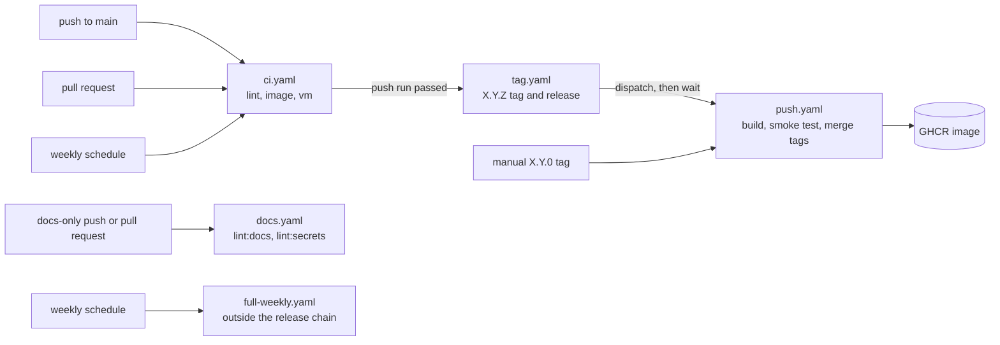

# Maintenance reference

Facts for the person who maintains the repository: the GitHub Actions workflows, the release chain, the timeouts and the repo tasks. [testing.md](testing.md) holds what the tests prove, [architecture.md](architecture.md#ci-mirrors-local-tasks-and-releases-are-safe-to-repeat) explains the decisions behind the workflows, and [guidance.md](guidance.md) has the procedures.

## Workflows

| File | Runs on | Permissions | Does |
| --- | --- | --- | --- |
| `ci.yaml` | Pushes to `main`, pull requests, a weekly schedule, and `workflow_dispatch` | `contents: read` | Runs the jobs that [testing.md](testing.md#jobs-in-ciyaml) describes. |
| `docs.yaml` | Pushes to `main` and pull requests that touch `docs/**`, `**/*.md`, or `llms.txt`, except `home/.config/pi/**` and `home/.config/omp/**` | `contents: read` | Runs two jobs. `lint-docs` runs `mise run lint:docs`, and `secrets` runs `mise run lint:secrets` (gitleaks over the whole history). Both check out with `fetch-depth: 0`, and `mise-action` installs only mise (`install: false`). `secrets` sets `MISE_LOCKED` and receives no token. It never releases. |
| `tag.yaml` | A completed `ci.yaml` run on `main` | none at the top. The job has `contents: write`, `actions: write`, and `checks: read`. | Tags and releases a commit that passed, dispatches `push.yaml`, and waits for it. |
| `push.yaml` | A semver tag push, or a dispatch by `tag.yaml` | none at the top. `build-images` has `contents: read` and `packages: write`, and `merge` has `packages: write`. | Publishes the images to GHCR. |
| `full-weekly.yaml` | A weekly schedule and `workflow_dispatch` | `contents: read` | Builds the `full` image (the base with the desktop, plus `agent` and `full`; it ran out of runner disk once, so the first step prints `df -h /`), runs `djd doctor` in it, then runs `djd update` and `djd doctor` in it. It sits outside the release chain, so a red run never blocks a release. |

`ci.yaml` skips a push or pull request that touches only `docs/**`, Markdown files, or `llms.txt`, except `DESIGN.md`, `home/.config/pi/**` and `home/.config/omp/**`. The instructions in those two trees (`AGENTS.md` and `RULES.md`) ship in the image and the image test checks them, so a change there runs CI, tags, and releases. `lint` checks `DESIGN.md`, so a change to it runs both `ci.yaml` and `docs.yaml`. `docs.yaml` takes the other side of the filter for everything else, so a docs-only change still gets `lint:docs`, which checks links, anchors, repo paths, commands, `DJD_` variables, and the test list, and a gitleaks scan, because a Markdown file can hold a key as well as any other.

The weekly schedule catches upstream breakage, because tools track `latest`. Scheduled runs never release, because `tag.yaml` accepts push runs only. Each event has its own concurrency group, so a scheduled run never cancels the push run that a release waits for.

GitHub disables scheduled workflows in a public repository after 60 days without repository activity. That stops the weekly `ci.yaml` run and `full-weekly.yaml` without a message. Enable them again in the Actions tab.

## CI and release chain

## Timeouts

| Job | Timeout | Measured |
| --- | --- | --- |
| `ci.yaml` `lint` | 15 min | 24 s |
| `ci.yaml` `image` | 30 min | 657 s on amd64 and 514 s on arm64, of which `test:desktop` took 115 s and 111 s |
| `ci.yaml` `vm` | 25 min | 212 s on amd64 and 204 s on arm64; `test:vm` itself waits up to 900 s for cloud-init and prints why it failed, so the job limit has to stay above that |
| `docs.yaml` `lint-docs` and `secrets` | 10 min each | 15 s and 8 s |
| `push.yaml` `build-images` | 30 min | 449 s on amd64 and 514 s on arm64 |
| `push.yaml` `merge` | 10 min | 14 s |
| `tag.yaml` release job | 60 min | 574 s for the run that published release 0.0.9, which waits for `push.yaml` |
| `full-weekly.yaml` | 60 min | 1277 s on 8 November, before the desktop moved into the base; the image is now about 5 GB larger, and the run has not been measured again |

The measured values are single runs from 9 November 2026 (the CI run of commit 8e257db and the release that followed it), except the `full-weekly.yaml` row. A timeout covers the slowest expected case with room, and it also limits how long a hung job holds its token. `full-weekly.yaml` prints `df -h /` first, because its one red run died with `No space left on device` and left no log.

## Release chain

`tag.yaml` runs after a CI run from a push to the `main` branch of this repository passes.

- It releases a commit only when the commit contains the newest `X.Y.Z` tag. For any other commit it prints a `::warning::` and ends green, so a release that was held back shows in the run summary.
- It bumps the patch number only. A minor or major bump is a manually pushed `X.Y.0` tag, and `push.yaml` builds images for it. If that tag already points at the commit that CI on `main` just finished, `tag.yaml` reuses it. It creates the release if none exists, and it dispatches `push.yaml` again. The dispatch is in the concurrency group of `push.yaml`. If the run that the tag push started is still going, the dispatch cancels it. If that run has finished, the dispatch rebuilds the images and overwrites them.
- It stops with an error that says to run it again when the patch tag it computed appears on the remote between its fetch and its check. A minor or major tag pushed in that window is not detected. It never cancels a release that is running. The concurrency group sits on the release job, so only runs that pass the job's `if` (a green push run of this repository) queue. One run waits per group, and a newer waiting run replaces an older one. The commits of the replaced run are inside the tag of the newer run.
- Tags are strict SemVer without leading zeros (`1.2.08` is not a release tag), because a leading zero breaks the patch arithmetic.
- It marks a GitHub release `latest` only when its tag is the newest.
- It writes the release notes itself. They list the commits since the previous `X.Y.Z` tag and the `docker pull` commands for both images, because `--generate-notes` lists only pull requests and the pushes to `main` have none.
- It creates the release first. Only a new release goes on to publish. A re-run of CI for a commit that already has a release finds it, prints the retry command, and dispatches nothing.
- It dispatches `push.yaml`, because tags that `GITHUB_TOKEN` pushes start no workflow, and records a UTC timestamp first.
- It finds the dispatched run by polling `gh run list` up to 12 times, 5 s apart, for a `workflow_dispatch` run of this tag that is not older than the timestamp. It takes the newest. When none appears within a minute, the step fails.
- It then runs `gh run watch --exit-status --compact --interval 30` on that run, so a failed publish fails `tag.yaml`. The person whose push produced the release gets the notification, because `push.yaml` itself runs as the bot. The job needs `checks: read` for this, because `gh run watch` reads check-run annotations and `GITHUB_TOKEN` lacks that once any permission is set. A newer `gh` may skip a failed annotation fetch, which was not confirmed.
- It holds its concurrency group while it waits, which took 8 min 9 s and 7 min 10 s in the two measured runs (see Timeouts). A later release queues behind it, and GitHub keeps only the newest pending run.
- A failed publish leaves the `tag.yaml` run red. Re-running it does not retry the publish, because the release exists. [Retry a failed publish](guidance.md#retry-a-failed-publish) has the steps.

The wait and the smoke test have run on GitHub: releases 0.0.6 (5 November 2026) and 0.0.7 (6 November 2026) passed the `tag.yaml` step "Trigger GHCR build and wait for it" and the smoke step of all four builds. No failed publish has turned the job red yet.

`push.yaml` builds the image for each platform with no build cache and pushes by digest. A smoke step then pulls the pushed image by digest and runs `docker run --rm "$REGISTRY_IMAGE@$DIGEST" sh -c "$SMOKE"`. `SMOKE` is `djd doctor`, so each architecture runs it on its own runner. The merge job creates the multi-arch tags only when every leg passed, so a red smoke test moves no tag. For the desktop flavor, doctor with `desktop` selected greps `xrdp.ini` for `security_layer=tls` and `sesman.ini` for `AllowRootLogin=false`. The desktop leg is the one most likely to fail first.

| Image | Tags that move with the newest release | Fixed tag |
| --- | --- | --- |
| the image | `latest` and `X.Y` | `X.Y.Z` |

A tag push publishes only a commit that is on `main`: the first job of `push.yaml` asks the GitHub compare API and fails for any other commit, because anyone who can push a tag would otherwise publish an unreviewed commit with a `packages: write` token. A floating tag moves only when the release is the newest `X.Y.Z` tag. A fixed tag is written once per release, because a re-run of CI does not dispatch `push.yaml`. A retry rebuilds and overwrites it on purpose.

- The merge job writes `description`, `source`, `licenses`, and `version` as index annotations, because GHCR reads the description of a multi-arch package from the index. `docker buildx imagetools create` writes no index annotations unless you pass `--annotation`. A test against a local registry with a docker-container builder confirmed both facts, and the first release confirmed them on GHCR for `sandbox` and `desktop`.
- The images that `push.yaml` builds carry the commit in `DJD_REVISION`, because `.git` is not copied into them.
- GitHub documents private as the default visibility of a new package. The first release of this repository published it as public.

## Workflow audit

jactionlint audits the workflows, and lint runs it.

- Checkouts drop the token with `persist-credentials: false`, except in `tag.yaml`, which pushes the tag.
- Every `uses:` is pinned to a commit.
- `push.yaml` and `tag.yaml` set `permissions: {}` at the top, and every job sets its own. Values such as `matrix.platform` and the build digest reach scripts through `env:`, not through `${{ }}` in the script.
- Both `setup-buildx` steps in `push.yaml` set `cache-binary: false`. The input has no effect while no buildx version is pinned; it keeps a pinned binary out of the Actions cache if one is added. The release builds use no layer cache because they set no `cache-from` or `cache-to`.
- Three findings are ignored inline, each with its reason beside it. One is the guarded `workflow_run` trigger in `tag.yaml`. The other two are the locally built image that two steps of `full-weekly.yaml` run.

[SECURITY.md](../SECURITY.md#github-tokens) lists the token permissions of each workflow.

The repository settings that the YAML cannot hold are a checklist in [guidance.md](guidance.md#harden-the-repository-settings), with the reasons in [SECURITY.md](../SECURITY.md#workflows-and-releases).
## Repo tasks and the lock

Repo tasks are mise file tasks in `.mise/tasks/`, plus a few in `.mise/config.toml`. Each task declares its description, its arguments with `#USAGE` and `choices`, its dependencies, and the tools it needs with `tools` or a `#MISE tools=` header. `test` depends on `build`, so `mise run test` builds what it tests. `mise tasks validate` checks the definitions, and the file tasks are plain bash that lint checks like every other script.

`.mise/mise.lock` pins tool versions with checksums for the platforms in `lockfile_platforms` in `.mise/config.toml`: `linux-x64`, `linux-arm64`, and `macos-arm64`. `mise lock --bump` moves the pins without installing anything. The npm graph that sits beside the lock is in `.mise/locks/`. `npm.package_manager = "aube"` in `.mise/config.toml` selects it, because the bun of the agent module cannot install a locked aube graph.

The `lint` job sets `MISE_LOCKED=true`. Its install uses only the URLs and checksums in `.mise/mise.lock`, so its install steps call no GitHub API and need no token, and it fails when the lock lacks a tool. [SECURITY.md](../SECURITY.md#github-tokens) says which token each workflow step receives. `min_version` in `.mise/config.toml` and in `mise-config/config.toml` makes an older mise stop with an error.

