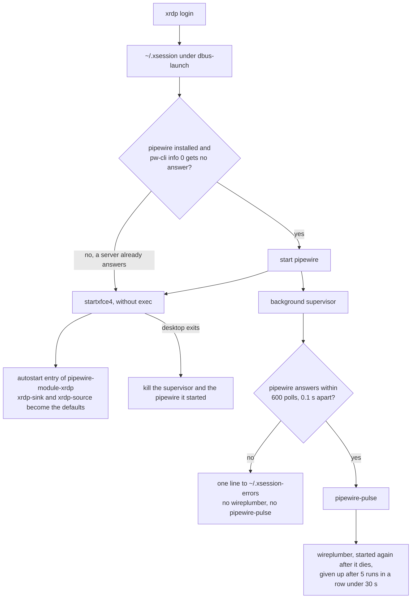

# Reference

Lookup tables for the repository. [architecture.md](architecture.md) explains the reasons behind them.

## Terms

| Term | Meaning |
| --- | --- |
| VM | A fresh Ubuntu 26.04 machine with systemd that `test:vm` starts from `cloud-init/vm.yaml`. In CI it is an incus system container, which shares the runner's kernel. On a Mac it is a multipass or an OrbStack machine. |
| part | One step of `mise bootstrap`, such as `packages`, `files`, `dotfiles`, or `tools`. `--only` and `--skip` take the part names. This is mise's word. |
| flavor | The set of modules that one Docker image installs, passed as `DJD_MODULES`. `sandbox` is `agent`, `desktop` is `agent desktop`, and the local `full` is `agent full`. |
| checkout | The git working tree at `~/.dotfiles`, which can be a symlink to a tree elsewhere. `~/.config/mise` links to its `mise-config/`. |
| image test | A task that builds a Docker image and asserts inside containers of it. `test` tests the sandbox image, and `test:desktop` tests the desktop image. `test:vm` is the VM test. |
| module | A mise config environment, `mise-config/config.<module>.toml`, that `djd module add` selects. The base config always applies. The modules are `agent`, `server`, `desktop`, `full`, and `secrets`. |
| hook | A script that mise runs before or after a bootstrap part. The scripts are in `mise-config/hooks/`. |
| shim | A small executable in `~/.local/share/mise/shims` that runs the version of a tool that mise selects. |
| drop-in | A small file in a `*.d` directory that adds to or overrides the main config file, such as `/etc/ssh/sshd_config.d/10-djd.conf`. |
| dotfile group | The files under one top-level directory (`home`, `agent`, or `desktop`) that mise links into `~`, one symlink per file. |
| drift | A difference between what the config declares and the state of the machine. `mise bootstrap status` and `djd doctor` report it. |
| converge | To apply the config until no drift is left. `djd apply` converges, and `djd doctor` together with `mise bootstrap plan --detailed-exitcode` tells whether it did. |
| floating tag | An image tag that moves to each new release, such as `latest`, `sandbox`, or `X.Y`. A fixed tag such as `X.Y.Z` is written once. |
| digest | The SHA-256 hash that names one exact image or file. |
| smoke test | A short run that shows the basics work. Here it is `djd doctor` in a pushed image. |
| attestation | A signed statement about how an image was built. The image index lists it as an `unknown/unknown` entry. |
| TOFU | Trust on first use. A client accepts a server's certificate the first time and warns when it changes. |
| NLA | Network Level Authentication. The RDP client proves who the user is before the session starts, through CredSSP. |
| CredSSP | The Windows protocol that carries the credentials of NLA. The xrdp of this repository offers none. |
| snakeoil | The self-signed placeholder key and certificate that the Ubuntu `ssl-cert` package makes when it is installed. |

## Layout

The tree shows the main parts. `git ls-files | cut -d/ -f1 | sort -u` lists every top-level entry.

```
install.sh              entry point: checks for Ubuntu 26.04, links ~/.dotfiles and ~/.config/mise, installs mise, runs djd tasks
Makefile                make <task> runs mise run <task>, with a few exceptions
mise.toml, mise.lock    repo tasks and the tools each task declares, pinned in mise.lock and in .mise/locks/
mise-tasks/             repo file tasks: lint/, build, test/ (_default, offline, desktop, vm), ci
.actrc                  act runner images for mise run ci
README.md, SECURITY.md  the entry page, and the security policy with the hardening and its limits
AGENTS.md               rules for coding agents, where each kind of change goes, verification commands
DESIGN.md               design tokens in the google-labs-code/design.md format
llms.txt                index of the docs for language-model readers
docs/                   architecture.md, reference.md, ci.md, how-to.md, history.md
mise-config/            linked as ~/.config/mise, the global config
  config.toml           base module: settings, core tools, base apt packages, locale, login shell, zsh plugin clones, dotfile group home
  config.<module>.toml  the modules agent, server, desktop, full, and secrets
  tasks/djd/            the djd commands, as global file tasks
  hooks/                dotfile-conflicts, server-post-packages, server-pre-dotfiles, sshd-keys-only, and desktop-final: hook scripts that are too long for an inline [bootstrap.hooks] string, and the helpers they share
home/                   dotfile group home, symlinked file by file into ~
agent/                  dotfile group agent: the global AGENTS.md of pi and omp
desktop/                dotfile group desktop: .xsession, fcitx5, ghostty, and zed
tests/                  tree.sh, tree-check.sh, vm-checks.sh, desktop-apps.sh, xsession-audio.sh, djd-module.sh, and server-hooks.sh
.agents/                coding-agent skills for this repository, one directory each
skills-lock.json        source and hash of each skill in .agents/
cloud-init/             cloud-init files for incus, multipass, and OrbStack
.devcontainer/          Dockerfile, desktop entrypoint, compose.yaml, devcontainer.json
.githooks/              pre-commit hook that runs gitleaks
.github/workflows/      ci.yaml, tag.yaml, push.yaml, full-weekly.yaml, docs.yaml
```

`tests/tree.sh` writes the tracked and unignored files as a tar stream, judged by the repository's own `.gitignore` alone: the git configuration and the global ignore file of the machine have no effect. `mise run ci`, `test:vm`, `test:offline`, and the no-trust flow in [AGENTS.md](../AGENTS.md) use it. `tests/vm-checks.sh` holds the assertions that `test:vm` runs inside the VM, and it refuses to run anywhere else (see `DJD_TEST_VM`). [ci.md](ci.md#test-map) maps each test script to the task that runs it.

## Modules

A module is the file `mise-config/config.<module>.toml`. `djd module add` and `djd module remove` write the selection to `~/.config/mise/miserc.local.toml` as `env = [...]`, in the order `agent server desktop full secrets`.

The selection is mise's `MISE_ENV`. A project that selects its own environment (`MISE_ENV`, or `env` in a project `.miserc.toml`) replaces it there, and module tools such as node and pi fail with `No version is set for shim`. The base tools still work. To keep the module tools in such a project, list the machine's modules in its `.miserc.local.toml` as well, for example `env = ["agent", "dev"]`. A process started through a shim passes `MISE_ENV=<modules>` to its children, and that value outranks the `.miserc.toml` of the project they run in. Run `mise -E agent,dev ...` there. mise has no setting that stops it passing `MISE_ENV` on.

| Module | apt packages | mise tools | Runs in |
| --- | --- | --- | --- |
| base, from `config.toml` | `ca-certificates curl git zsh sudo locales tzdata less vim unzip tree sqlite3 openssh-client gnupg fastfetch make` | `usage starship zoxide fzf ripgrep fd bat lsd sd jq yq delta gh lazygit jj jj-starship bottom micro herdr shellcheck shfmt` | every machine |
| `agent` | `build-essential pkg-config libssl-dev` | `node` at the lts channel, `bun`, `python`, `uv`, `pi`, `omp`, `skills` | sandbox image, desktop image |
| `server` | `openssh-server avahi-daemon ufw docker.io docker-compose-v2 docker-buildx` | `lazydocker` | VMs |
| `desktop` | `xfce4 xfce4-terminal xfce4-screenshooter xfce4-taskmanager xfce4-clipman-plugin xfce4-xkb-plugin xrdp xorgxrdp pipewire pipewire-pulse wireplumber pipewire-module-xrdp pulseaudio-utils dbus-x11 fcitx5-mozc language-pack-ja language-pack-ja-base manpages-ja fonts-noto-cjk fonts-noto-color-emoji ghostty brave-browser libasound2t64 mesa-vulkan-drivers xsel xdotool` | `zed` and `zen`, both from GitHub releases, and `hackgen`, the HackGen NF font from an `http:` URL | desktop image, VMs |
| `full`, which requires `agent` | 33 packages, counted in the section below | 181 tools | opt-in, and the weekly CI |
| `secrets` | none | none | machines you own, never sandboxes |

What each module declares besides packages and tools, by `mise bootstrap` part:

| Module | `files` | `services` and `firewall` | `repos` | Dotfile group | Login shell | Hooks | `[env]` |
| --- | --- | --- | --- | --- | --- | --- | --- |
| base | `/etc/locale.conf` with `C.UTF-8` | | seven pinned zsh plugins | `home` | `zsh` | `pre-user`, `pre-dotfiles` | |
| `agent` | | | | `agent` | | `pre-dotfiles` | npm and bun locations, `PI_TELEMETRY`, `DO_NOT_TRACK` |
| `server` | `10-djd.conf`, `daemon.json` | docker restarts when `daemon.json` changes, ufw rules | | | | `post-packages`, `pre-dotfiles` | |
| `desktop` | `/etc/locale.conf` with `ja_JP.UTF-8`, `90djd-conffiles` (`pre-packages`) | | | `desktop` | | `pre-dotfiles`, `final` | `ZED_UPDATE_EXPLANATION` |
| `full` | | | | | | | |
| `secrets` | | | | | | | age ciphertext values, none committed today |

`full` declares only packages, tools, and the cargo and rust `[settings]`. `secrets` sets `experimental`, `age.key_file`, and `age.strict` in `[settings]`. `desktop` also declares the apt source of Brave under `[bootstrap.apt.sources.brave-browser]`.

### Files that modules manage

Base:

- The dotfile group `home`.
- The login shell `zsh`.
- `/etc/locale.conf` set to `C.UTF-8`.
- Seven zsh plugins under `~/.local/share/zsh/plugins/<name>`, as `[bootstrap.repos]` entries pinned to a commit with `ref`. A commit `ref` rules out `depth`, so they are full clones. `mise bootstrap repos apply` prints the git advice text about a detached HEAD, which is noisy and harmless. Drift of a clone shows in `mise bootstrap status` and `djd doctor`. To update a plugin, set a newer `ref`.

`agent`:

- The dotfile group `agent`: `~/.pi/agent/AGENTS.md` and `~/.omp/agent/AGENTS.md`, the global instructions that pi and omp each read from their own agent directory. The two files have the same content.
- `[env]` values that every program started through a mise shim sees, in any shell type: the npm and bun locations, `PI_TELEMETRY=0`, and `DO_NOT_TRACK=1`. `sh -c`, `bash -lc`, and `zsh -lc` do not see them, because none of them is a shim. `echo $DO_NOT_TRACK` in `zsh -lc` prints nothing.
- `[env]` wins over `profile.local` for the tools that mise shims start. With `export DO_NOT_TRACK=0` in `~/.config/djd/profile.local`, `zsh -lc` prints `0` and a shimmed tool still sees `1`. The same key in `~/.config/mise/config.local.toml` overrides it.
- `pi` and `omp` are the exception to `minimum_release_age = "3d"` (`minimum_release_age_excludes` in `config.agent.toml`): they install on the day they release, because they release often and the owner wants each release at once.

`server`:

- The sshd drop-in `/etc/ssh/sshd_config.d/10-djd.conf` allows keys only and denies root login. The `pre-dotfiles` hook `hooks/server-pre-dotfiles` checks it.
- ufw denies incoming traffic, limits 22/tcp, and allows 3389/tcp from private networks only. No mDNS rule exists, because `before.rules` of ufw already accepts multicast.
- `/etc/docker/daemon.json` binds published ports to `127.0.0.1` by default, through `ip` and `default-network-opts`. docker restarts when the file changes.
- The `post-packages` hook refuses the apply before the drop-in is written when it runs as root, when the user has no authorized key, or when sshd listens on a port other than 22: each would lock the user out once passwords and root login are off and the firewall allows port 22 only. It adds the user to the `docker` group only after those checks. `DJD_SKIP_SSH_CHECKS=1` skips the refusals.
- `djd module remove server` deletes the sshd drop-in and `daemon.json`, so password logins and published ports on every address return. It leaves the packages and the ufw rules, so SSH stays reachable, and it prints a warning.

`desktop`:

- `/etc/locale.conf` is set to `ja_JP.UTF-8`, which overrides base. `/etc/default/locale` links to it.
- The dotfile group `desktop`. Its `~/.xsession` starts the audio daemons for the session, as the diagram below shows.
- Audio over RDP comes from the package `pipewire-module-xrdp`. An XDG autostart entry of that package loads `xrdp-sink` and `xrdp-source` into the session's PipeWire and makes them the defaults through `pactl`, from `pulseaudio-utils`.
- The four required apps. `ghostty` comes from the Ubuntu archive. `brave-browser` comes from Brave's apt repository, declared in `[bootstrap.apt.sources.brave-browser]` with `suites = "stable"` and three pinned key fingerprints. `zed` and `zen` are `github:` tools at `latest`, with a per-platform `asset_pattern`. [architecture.md](architecture.md#the-desktop-apps-each-carry-a-trust-anchor) explains what verifies each one.
- Each app has an XFCE menu entry. Brave and ghostty use the entries of their packages. The `postinstall` of `zed` and `zen` writes `~/.local/share/applications/dev.zed.Zed.desktop` and `zen.desktop` with `Exec` on the mise shim, and installs the icon. `filter_bins = "zen"` keeps `zen-bin`, `updater`, `pingsender`, and `gfxtest` off `PATH`.
- The `postinstall` of `zen` also writes `distribution/policies.json` with `DisableAppUpdate` and `DisableTelemetry`, and the module's `[env]` sets `ZED_UPDATE_EXPLANATION` for Zed, so neither app replaces files in the mise install directory ([architecture.md](architecture.md) and [SECURITY.md](../SECURITY.md) give the reasons).
- The Docker image, not the module, writes a user-level `~/.local/share/applications/brave-browser.desktop` that adds `--no-sandbox` to every `Exec` line.
- `tests/desktop-apps.sh` checks all four apps. `mise-tasks/test/desktop` runs it in the image with `DJD_APPS_LAUNCH=1`, which also starts Brave and Zen headless and opens a new window for ghostty and Zed inside the RDP session, and `tests/vm-checks.sh` runs it in the VM without the variable.
- HackGen NF is the `http:hackgen` tool, pinned to a version and a SHA-256. Its `postinstall` copies the four `.ttf` files to `~/.local/share/fonts/HackGen` and runs `fc-cache -f`, and the install fails without `fc-cache`. The sandbox image has none, and the desktop module declares no `fontconfig` package, so it relies on a dependency of the desktop packages (inference, not checked). `hooks/desktop-final` makes no download, and no `.version` stamp file exists any more.
- The `final` hook purges light-locker, xscreensaver, im-config, and the pulseaudio daemon, which would claim the pulse socket next to pipewire-pulse. It sets `security_layer=tls` in `/etc/xrdp/xrdp.ini` and `AllowRootLogin=false` in `/etc/xrdp/sesman.ini`, and it restarts a running xrdp once per change, because the daemon keeps the values it started with (with an RDP session open it prints the restart command instead, and the next apply tries again; `djd doctor` reads the files, and `tests/vm-checks.sh` compares the daemon's start time). Never write `security_layer=hybrid` there. See [RDP security](#rdp-security-and-known-limits).
- `/etc/apt/apt.conf.d/90djd-conffiles` sets `--force-confdef` and `--force-confold` for every apt run on the machine, so `djd update` keeps the edited xrdp conffiles and never stops at dpkg's conffile prompt. A new maintainer version lands beside the file as `*.dpkg-dist`.
- The dotfile `desktop/.config/zed/settings.json` turns Zed's telemetry and auto-update off. Zed may rewrite the file through its symlink.

How `~/.xsession` starts audio, read from `desktop/.xsession`:



- The desktop does not wait for the audio daemons. The supervisor polls first because wireplumber exits when it starts before the server answers.
- `pw-cli` is asked, and the socket file is not tested. A socket file that a dead server left behind does not count, and a server that already answers is never touched or killed. In a VM, systemd's socket-activated server should answer the check, so that nothing starts twice. That case was not tested in a VM.
- The supervisor ends its own wireplumber and pipewire-pulse when it gets TERM. Logging out would otherwise leave the daemons running, and the supervisor would start a wireplumber against the dead session bus. A session that only disconnects keeps running and loses nothing.
- Two limits remain. `pipewire-module-xrdp` loads its module from a background `pw-cli`, so each login leaves one idle `pw-cli` behind. Nothing restarts `pipewire-pulse` or the pipewire server when either dies, and a `wireplumber` that dies five times in a row within 30 s of starting stays off until the next login.

`secrets`: `[env]` values stored as age ciphertext.

### Size of the full module

The `full` module has 33 apt packages. 21 are CLI packages, such as build libraries and network tools. 12 carry `env = "desktop"`, so they install only when `desktop` is selected too. They are GTK and WebKit development libraries, flatpak, and a terminal music stack (`mpd`, `mpc`, `ncmpcpp`). The 181 tools were carried over from the repository that this one started from ([history.md](history.md)). ruby comes from mise only, and sqlite3 and fastfetch come from the base apt list. dotnet is commented out because its installer rejects 26.04, and vegeta and taskctl install on amd64 only.

These commands regenerate the counts. They print 181 tools, 33 apt packages, and 12 packages with `env = "desktop"`.

```sh
awk '/^\[tools\]/{t=1;next} /^\[/{t=0} t&&/^"?[a-z]/' mise-config/config.full.toml | wc -l
awk '/^\[bootstrap.packages\]/{p=1;next} /^\[/{p=0} p&&/^"apt:/' mise-config/config.full.toml | wc -l
grep -c 'env = "desktop"' mise-config/config.full.toml
```

Plan for at least 10 GB of free disk. That figure is an estimate. One install of 155 of the 181 tools used 7.5 GB of installs plus 2.5 GB of cache. It was measured once, in October 2026, on an arm64 Mac running OrbStack. The other 26 tools were not measured.

## djd commands

`home/.local/bin/djd` routes `djd <cmd> [args]` to `mise run djd:<cmd> [args]`. It runs from `$HOME` with `MISE_TASK_RUN_AUTO_INSTALL=false` and `LC_ALL=C.UTF-8`. Plain `djd` lists the commands. `install.sh` ends by running this wrapper, so it gets the same environment.

| Command | Does |
| --- | --- |
| `djd apply [flags]` | Runs `mise bootstrap --yes --update` and clears the shell init caches. It moves no file itself. Real files that a dotfile would replace are moved aside by the `pre-dotfiles` hook (see Bootstrap phases and hooks). |
| `djd update` | Runs `git fetch` and `git merge --ff-only @{u}`, then `mise self-update`, then `djd apply --upgrade`. It prints a message and skips the pull when `~/.dotfiles` is not a git checkout, when no branch is checked out (a detached HEAD, which a jj colocated checkout always has), or when the branch has no upstream. A dirty file that the update does not touch stays. |
| `djd status` | Prints the checkout path and commit, the selected modules, and `mise bootstrap status`. |
| `djd doctor` | Checks Ubuntu 26.04 (`VERSION_ID`), the `~/.config/mise` link, the zsh login shell, `bootstrap status --missing` (which includes a missing or drifted zsh plugin clone), and `dot status --missing`, and lists each dotfile that differs from the checkout. Hooks are imperative and `bootstrap status` cannot see what they enforce, so it also checks them. With `server` selected, it checks that sshd is keys-only through `hooks/sshd-keys-only`, which evaluates `sshd -T -C` for the current user whenever a `Match` line exists. With `desktop` selected, it checks `security_layer=tls` in `xrdp.ini` and `AllowRootLogin=false` in `sesman.ini`, each on its own line. With the `secrets` module selected, it also checks that `~/.config/djd/age.txt` exists, has no group or other permission bits (mode 0600 and 0400 pass), and decrypts every value. Exits with code 1 on any failure. |
| `djd module list` | Prints each module and whether it is selected. It rejects module names (exit 2). |
| `djd module add <module>...` | Selects the modules (a missing or unknown name exits 2 with a message) and applies the selection. `full` selects `agent` too. Prints a warning when `desktop` is selected without `server`, because only `server` carries the RDP firewall rules. |
| `djd module remove <module>...` | Unselects the modules, unapplies their files and dotfile groups, and applies what remains, so base declarations such as the locale come back. A module that was never applied causes no error. It refuses to remove `agent` while `full` is selected (exit 2). `remove desktop` also deletes `/etc/apt/sources.list.d/mise-brave-browser.sources`, because mise never removes an apt source. The packages stay. |
| `djd secret keygen` | Creates the age key at `~/.config/djd/age.txt`. |
| `djd secret set <name>` | Encrypts a prompted value into the secrets module. The task is `raw=true` ([architecture.md](architecture.md#secrets-use-the-age-support-of-mise) says why). |

Only `djd module` and `djd secret` declare arguments, so only their `--help` lists them. `djd apply`, `djd update`, and `djd status` pass extra flags to the mise command they run, as in `djd apply --upgrade`. `djd doctor` ignores them. The `djd` wrapper unsets your own `MISE_ENV`, which would otherwise replace the module selection, and `install.sh` inherits that through the wrapper.

## Make targets

`make <task>` runs `mise run <task>`, and `make <task> ARGS=<args>` passes arguments. `make build ARGS=desktop` runs `mise run build desktop`. `make` hands `ARGS` to the recipe as an environment variable, and the shell splits it into words. It never reads `ARGS` as shell syntax, so `ARGS='x; cmd'` passes the two words `x;` and `cmd`. `make help` lists the tasks. Two groups differ.

- `make init` runs `./install.sh $(ARGS)`. It runs before mise exists, so the machine needs make. A fresh Ubuntu cloud image can lack it, and `sudo apt-get install make` adds it. `./install.sh` needs no make, and the base apt list installs make for later runs.
- `make apply`, `make update`, `make status`, `make doctor`, `make module`, and `make secret` run `djd`, so they keep its locale and its working directory.

## Bootstrap phases and hooks

`mise bootstrap --help` documents the order (the `min_version` in `mise-config/config.toml` is the release that this repository follows). It applies the parts that the config declares in this order, and the `--only` and `--skip` flags take the part names. The table lists only the parts that this repository uses, with the hooks that run around them. It leaves out `accounts`, `plugins`, `compose`, the shell-activation, macOS and systemd-unit parts, and the `bootstrap` task, because the repository declares none of them. The row numbers are this table's own order, not mise's step numbers.

| # | Part | Hook around it | Declared by | The hook does |
| --- | --- | --- | --- | --- |
| 1 | `files` with `phase = "pre-packages"` | | | |
| 2 | `packages` | `post-packages`, right after | `server` | Runs `hooks/server-post-packages`. It refuses the apply, before step 3 writes the sshd drop-in, when the apply runs as root, when `~/.ssh/authorized_keys` (or `authorized_keys2`) holds no key, or when sshd listens on a port other than 22. Only after those checks does it add the user to the `docker` group. `DJD_SKIP_SSH_CHECKS=1` skips the refusals, and the hook still adds the user to the group. |
| 3 | the other `files`, then `services`, then `firewall` | | | |
| 4 | `repos` | | | |
| 5 | `dotfiles` | `pre-dotfiles`, before | base, `agent`, `desktop` | Run `hooks/dotfile-conflicts <group>` for the dotfile group `home`, `agent`, or `desktop`. It deletes a real file that equals its `/etc/skel` copy, and moves any other real file that a dotfile would replace to `<file>.djd-backup-<epoch>-<pid>`, where `<epoch>` is the time in seconds and `<pid>` is the process ID of the hook. |
| 5 | `dotfiles` | `pre-dotfiles`, before | `server` | Runs `hooks/server-pre-dotfiles`, which fails the apply unless the sshd drop-in is in effect (`hooks/sshd-keys-only` makes the check, and `djd doctor` shares it). It runs after the base and `agent` hooks, so an apply that fails here can leave files moved aside. |
| 6 | `user` (the login shell) | `pre-user`, before | base | Switches the login shell to zsh through sudo. |
| 7 | `tools` | | | |
| 8 | `final-hook` | `final` | `desktop` | Runs `hooks/desktop-final`. It purges the packages that break xrdp sessions (it waits up to 120 s for the dpkg lock), makes xrdp TLS-only without root logins, and restarts a running xrdp once per change (not while an RDP session is open, when it says so and the next apply tries again). |

A standalone `mise dot apply` also runs the `pre-dotfiles` and `post-dotfiles` hooks. mise runs the hooks of every selected module in order, base first, and only when their part runs, so `djd apply --dry-run`, `--skip dotfiles`, and `--only` without `dotfiles` move no file. mise runs hooks and the `bootstrap` task on every run, so a hook must be safe to repeat. [architecture.md](architecture.md#hooks-live-in-the-module-that-needs-them) gives the reasons for each hook.

The sshd check of `hooks/sshd-keys-only` covers the effective settings of the current user, not every possible login. [architecture.md](architecture.md#a-module-is-a-mise-config-environment) gives its scope.

## Shell startup files

| File | Read by | Does |
| --- | --- | --- |
| `~/.profile` | bash login shells and zsh through `.zshenv` | Sets the XDG directories, `DJD_DIR`, `PATH` with the mise shims and `~/.local/bin`, `LANG`, `TZ` with the default `Asia/Tokyo`, `EDITOR`, and the history files `PYTHON_HISTORY` and `NODE_REPL_HISTORY`. less keeps its history under the XDG state directory by its own rule, so `.profile` does not set `LESSHISTFILE`. Then reads `~/.config/djd/profile.local`. It is POSIX and has no side effects. |
| `~/.zshenv` | every zsh | Sets `skip_global_compinit=1`, so that the `compinit` of `/etc/zsh/zshrc` does not drop `.zcompdump` into `ZDOTDIR`. Sets `ZDOTDIR=~/.config/zsh` and sources `.profile`. |
| `~/.config/zsh/.zshenv` | every zsh that starts with `ZDOTDIR` already exported, which is a nested shell | Sources `~/.zshenv`, so nested shells load `.profile` too. |
| `~/.config/zsh/.zprofile` | zsh login shells | Starts herdr on a real terminal. It does not start herdr when `DJD_NO_MUX` is set, as the Docker images do, nor inside herdr, nor in an IDE terminal, nor for `zsh -lic cmd`. |
| `~/.config/zsh/.zshrc` | interactive zsh | Sets up history, completion (a dump younger than a day is reused with `compinit -C`), `mise activate` first, so that the tool inits after it find the installed binaries and not the shims, then starship, zoxide, fzf, atuin when installed (after fzf, so atuin owns Ctrl-R), the zsh plugins from `~/.local/share/zsh/plugins` through zsh-defer, and `.functions`, and reads `$ZDOTDIR/.zshrc.local`. The cached tool inits are keyed by the tool, its resolved binary path, and a checksum of the init command line, so an upgrade or an edited argument regenerates them. It exports `DJD_ARCH=x86_64` on x86_64, for the arch badge of starship. It skips a missing plugin clone without a message. Its `chpwd` hook runs `ls -la` in the top-level shell only. |
| `~/.config/zsh/.zlogin` | zsh login shells | Prints an interactive banner with fortune and cowsay, when installed. Prints a second banner with figlet and lolcat, when installed. A login shell that runs a command (`zsh -lc`, `zsh -lic`) prints nothing. |
| `~/.config/zsh/.zlogout` | interactive zsh login shells, on exit | Runs fastfetch, or prints a short banner when it is missing. `zsh -lc` does not read it, and `zsh -lic cmd` reads it but prints nothing. |
| `~/.bash_profile` and `~/.bashrc` | bash | Source `.profile`, then run the interactive-only setup: history (appended, not overwritten), starship, zoxide, omp completions, and `mise activate` before them, so that the cached inits are keyed by the installed binary's path. starship's init keeps the `PROMPT_COMMAND` it finds, so mise's hook survives. `.bashrc` exports `DJD_ARCH` like `.zshrc`. |

## Environment variables

The tables group the variables by where they matter. The scope names are install (`install.sh` and the djd tasks), login (login shells and anything that sources `.profile`), shim (a program started through a mise shim), image (the Docker image environment), build (a Docker build), tasks (the repo tasks), and compose (`.devcontainer/compose.yaml`).

### Install and djd

| Variable | Scope | Default | Effect |
| --- | --- | --- | --- |
| `DJD_DIR` | login | `~/.dotfiles` | Path of the checkout, which `.profile` always exports as `$HOME/.dotfiles`. It is not an override: `install.sh` and the djd tasks always use `~/.dotfiles`, because mise reads `~/.config/mise` and `dotfiles.root` there. |
| `DJD_REPO` | install | the GitHub URL of this repository | Repository that `install.sh` clones. |
| `DJD_SKIP_SSH_CHECKS` | install, tasks | unset | When non-empty, the server module's `post-packages` hook skips its refusals (no authorized key, root, a port other than 22). For a machine that is reached through a console, `incus exec` or `multipass exec`. `test:vm` sets it. |
| `MISE_VERSION` | install | the `min_version` of `mise-config/config.toml`, with a `v` prefix | mise release that `install.sh` installs when mise is missing or older than `min_version`. A value in the environment overrides the release to install, with or without the `v`. Without a `min_version`, `install.sh` stops. |
| `DJD_BOOTSTRAP_FLAGS` | install | empty | Extra flags that `djd apply` passes to `mise bootstrap`. The Docker build passes `--skip tools,dotfiles`, `--only tools`, and `--only dotfiles`. |
| `MISE_ENV` | install, shim | unset | The module selection, which mise reads from `miserc.local.toml`. The `djd` wrapper, and so `install.sh`, and `djd module` unset a value of your own. A shimmed process passes it to its children, where it outranks a project's `.miserc.toml` (see [Modules](#modules)). |
| `LC_ALL` | install | `C.UTF-8` | The `djd` wrapper forces it, because mise matches the English ufw output. `tests/vm-checks.sh` sets it too. |

### Login shells

| Variable | Scope | Default | Effect |
| --- | --- | --- | --- |
| `LANG` | login, image | `C.UTF-8` | `.profile` keeps a value that is already set. The images set `LANG=C.UTF-8` themselves, because `docker run` and `docker exec` read no `.profile`. `/etc/locale.conf` sets the system locale, and the `desktop` module changes it to `ja_JP.UTF-8`. |
| `TZ` | login | `Asia/Tokyo` | Time zone of login shells. `.profile` keeps a value that is already set. `docker exec` and shims do not read it, so a plain `docker run` of the sandbox image reports `UTC`. |
| `DJD_NO_MUX` | login, image | unset | When non-empty, `.zprofile` does not start herdr. The Docker images set it. |
| `DJD_ARCH` | interactive shell | unset | `.zshrc` and `.bashrc` set it to `x86_64` on x86_64 hosts. The `env_var.DJD_ARCH` module of `starship.toml` shows it as the arch badge. |

### Tokens

| Variable | Scope | Default | Effect |
| --- | --- | --- | --- |
| `GITHUB_TOKEN` | tasks, CI | none | A token without scopes, which only lifts the anonymous GitHub rate limit. `mise run build` and `mise run ci` stop when it is unset, and `test` and `test:desktop` build first, so they stop too. An empty `GITHUB_TOKEN=` runs anonymously. Never use `gh auth token`, which carries every scope of your login. `test:vm` hands it to mise in the VM when it is set. Builds pass it to Docker as a BuildKit secret. |
| `MISE_GITHUB_TOKEN` | build, install | none | The name that mise reads. The Dockerfile mounts the secret under it in the second `RUN`, `test` and `full-weekly.yaml` set it from `GITHUB_TOKEN`, and a curl install can pass it. The narrower name keeps gh and other tools from picking the token up inside the build. |

### Docker build and tests

| Variable | Scope | Default | Effect |
| --- | --- | --- | --- |
| `DJD_MODULES` | build | `agent` | Build argument of the Dockerfile. It lists the modules that a flavor installs. |
| `DJD_REVISION` | build, image | `unknown` | Build argument of the Dockerfile. `mise run build` sets it from `git describe --always --dirty` (a build from a modified tree ends in `-dirty`, and it is `unknown` without git), `push.yaml` sets the full commit SHA, and the builds of `compose.yaml` and `devcontainer.json` leave it unset. `djd status` prints it when the checkout has no `.git`. |
| `DJD_KEEP_VM` | tasks | unset | When exactly `1`, `test:vm` keeps its VM after the run. Any other value deletes it. |
| `DJD_MODULE_NO_BRAVE` | tasks | unset | When `1`, `tests/djd-module.sh` skips the Brave apt source check on a machine that has no such file. Without it, a missing file fails the test. `test:offline` creates the file. |
| `DJD_APPS_LAUNCH` | tasks | unset | When `1`, `tests/desktop-apps.sh` also starts the four apps. `test:desktop` sets it. |
| `DJD_TEST_VM` | tasks | unset | `tests/vm-checks.sh` refuses to run unless this is `1` and exits 2. Only `test:vm` sets it, inside the VM. The script changes the machine it runs on. |

### Compose

| Variable | Scope | Default | Effect |
| --- | --- | --- | --- |
| `RDP_PORT` | compose | `33389` | Host port that `compose.yaml` publishes on `127.0.0.1` for RDP. Set it in `.devcontainer/.env`. |
| `PASSWORD` | compose | required | RDP password of the desktop container. Set it in `.devcontainer/.env`. It must not contain a newline: the entrypoint exits 2 for one, because `chpasswd` reads one `user:password` pair per line. |
| `TUNNEL_TOKEN` | compose | none | Token of the optional cloudflared service, which is commented out in `compose.yaml`. When you enable it, the token goes in `environment` and not on the command line. |

A value that you export in your shell wins over `.devcontainer/.env` for `RDP_PORT` and `PASSWORD`. `PASSWORD` feeds the `djd_rdp_password` secret, which `docker compose config` does not render, so this was checked by reading `/run/secrets/djd_rdp_password` in a throwaway compose project whose `.env` held another value: the exported value was the one in the file. These names are generic, so a stray export silently becomes the RDP password or port. `PASSWORD` and `TUNNEL_TOKEN` are secrets.

Precedence in login shells and tools:

1. `.profile` keeps a value that is already set for the XDG variables, `LANG`, `TZ`, and `EDITOR`. It always sets `DJD_DIR`, `PYTHON_HISTORY`, and `NODE_REPL_HISTORY`. It reads `profile.local` last, so a value there wins in login shells.
2. The `[env]` table of a module reaches programs that start through a mise shim and interactive shells with `mise activate`. It does not reach `sh -c`, `bash -lc`, or `zsh -lc`.
3. For a shimmed program, `[env]` wins over `profile.local`. To override an `[env]` key there, set it in `~/.config/mise/config.local.toml`.

[SECURITY.md](../SECURITY.md#local-overrides) lists the machine-local override files.

## XDG locations

The shell files and tools put their files in these places. [architecture.md](architecture.md#files-follow-xdg-where-the-tool-allows) explains the choices.

| Kind | Location | Written by |
| --- | --- | --- |
| Configuration | `~/.config`, with `~/.config/zsh` as `ZDOTDIR`, `~/.config/npm/npmrc` for npm, and `~/.config/djd` for `profile.local`, `bashrc.local`, and `age.txt` | the dotfile deployment, `djd secret`, npm |
| History | `$XDG_STATE_HOME`: `zsh/history`, `bash/history`, `lesshst`, `python_history`, `node_repl_history`, `djd/sshd-dropin`, the stamp that makes `hooks/server-pre-dotfiles` reload sshd only when the drop-in changed, and `djd/xrdp-restart`, the stamp that makes `hooks/desktop-final` restart xrdp once per change | `.zshrc`, `.bashrc`, `.profile`, less, `hooks/server-pre-dotfiles`, `hooks/desktop-final` |
| Cache | `$XDG_CACHE_HOME`: `zsh/zcompdump-<version>`, `zsh/zcompcache`, `zsh/init/`, `bash/init/`, `npm/`, `bun/`, and `fast-syntax-highlighting/` (or `fsh/`, when the first is not writable) | `.zshrc`, `.bashrc`, npm, bun, fast-syntax-highlighting |
| Data | `$XDG_DATA_HOME`: `mise/` with the shims, `zsh/plugins/` with the zsh plugin clones, `fonts/`, `applications/` and `icons/` (the Zed and Zen menu entries, and in the Docker image Brave's), and `cargo/` and `rustup/` (the `full` module) | mise, the `postinstall` of hackgen, zed, and zen, the Dockerfile |
| Executables | `~/.local/bin`, which holds `djd` and the mise binary that `install.sh` installs | the dotfile deployment, `install.sh` |

less picks `$XDG_STATE_HOME/lesshst` itself when that directory exists, and falls back to `~/.local/state/lesshst`, then `~/.lesshst`. `~/.local/state` always exists on a mise machine, because mise creates `state/mise` there. fast-syntax-highlighting runs `curl` the first time it loads, in the deferred source of `.zshrc`, to download `secondary_theme.zsh` into its cache directory.

The `agent` module sets `NPM_CONFIG_CACHE`, `NPM_CONFIG_USERCONFIG`, and `BUN_INSTALL_CACHE_DIR` in the `[env]` table of `config.agent.toml`. mise shims apply them to any shimmed program, including one started from `docker exec` or `sh -c`, and the image build applies them too. The same table turns telemetry off with `PI_TELEMETRY=0`, which pi reads, and `DO_NOT_TRACK=1`, which skills reads. bun reads it too, but only to stop crash reports, which it sends by default on macOS and Windows and not on Linux. omp does not read it, and its only telemetry is an OTLP export that sends nothing until `OTEL_*` endpoints are set.

These files stay outside the XDG directories. A session in the sandbox image in October 2026 that ran bash, zsh, npm, bun, gpg, omp, pi, python, node, and vim created every entry from `~/.gnupg` down. The first four rows are files that the repository or the system places there on purpose.

| Path | Reason |
| --- | --- |
| `~/.profile`, `~/.bash_profile`, `~/.bashrc` | bash reads only these paths. |
| `~/.zshenv` | zsh reads it before `ZDOTDIR` is set. |
| `~/.xsession` | `/etc/X11/Xsession` hard-codes it. |
| `~/.dotfiles` | It is the default `dotfiles.root` of mise, and `install.sh` clones there. |
| `~/.gnupg` | A `GNUPGHOME` export in `.profile` would reach login shells and not `docker exec`, which would then use another keyring. |
| `~/.omp`, `~/.pi` | omp and pi keep their state there. The `agent` dotfile group also links `AGENTS.md` into `~/.pi/agent` and `~/.omp/agent`. |
| `~/.viminfo` | A `~/.config/vim/vimrc` with `viminfofile` can move it. The repository does not ship one. |

herdr keeps sockets and logs in `~/.config/herdr`, and micro keeps `buffers/` and `bindings.json` in `~/.config/micro`. Both directories are inside the XDG configuration directory, but they hold state.

## RDP security and known limits

xrdp 0.10.1 on Ubuntu 26.04, probed in November 2026 with FreeRDP 3.32.1 from a container against a server container on an arm64 host. The client image is amd64 and ran emulated. [SECURITY.md](../SECURITY.md#known-limits-of-the-rdp-service) summarizes the limits for reporters. This section keeps the evidence.

The repository sets three things, and `djd doctor` and `test:desktop` check the first two.

| Setting | File | Value | Set by |
| --- | --- | --- | --- |
| `security_layer` | `/etc/xrdp/xrdp.ini` | `tls` | `hooks/desktop-final` |
| `AllowRootLogin` | `/etc/xrdp/sesman.ini` | `false` | `hooks/desktop-final` |
| TLS key and certificate | `/etc/xrdp/key.pem`, `cert.pem` | new at every container start | `.devcontainer/desktop-entrypoint.sh`, with `make-ssl-cert generate-default-snakeoil --force-overwrite` |

Everything else is the xrdp package default.

### Protocol negotiation

Server with `security_layer=tls`. Each row is `xfreerdp3 /v:srv /u:ubuntu /p:... /cert:ignore <option>`, read against the `Security protocol` line of `/var/log/xrdp.log`.

| Client option | Result | `xrdp.log` |
| --- | --- | --- |
| none, like mstsc | connects | `configured [SSL], requested [SSL\|HYBRID\|HYBRID_EX\|RDP], selected [SSL]` |
| `/sec:tls` | connects | `requested [SSL\|RDP], selected [SSL]` |
| `/sec:nla` | refused, exit 133 | `requested [SSL\|HYBRID\|RDP], selected [SSL]`, then `SSL_accept ... unexpected eof` |
| `/sec:ext` | refused, exit 133 | `requested [SSL\|HYBRID\|HYBRID_EX\|RDP], selected [SSL]` |
| `/sec:rdp` | refused, exit 147 | `requested [RDP], selected []` |

- NLA does not exist in this xrdp. Nothing in `xrdp.ini` or the library offers CredSSP, and `sesman.ini` has no domain or authentication backend setting. A client that insists on CredSSP aborts, because the server picks TLS.
- `security_layer=hybrid` is not a valid value. The string `security_layer=%s is not recognized, will use security_layer=negotiate` is in `libxrdp.so`. A throwaway container with `hybrid` logged `configured [SSL|RDP]`, which equals `negotiate`. A typo or an upgrade to `hybrid` silently re-enables the legacy RDP layer.
- `negotiate` on this build selects `[SSL]` for a default client, but it still accepts a client that forces the legacy RDP layer. `test:desktop` uses a `negotiate` container as the control for that reason.
- Windows App and mstsc offer SSL and HYBRID like FreeRDP does and should take SSL. That is an inference and was not tested. A client forced to require CredSSP behaves like `/sec:nla` and fails.

### TLS versions and ciphers

A script sent an X.224 request for TLS, then pinned each version.

| Probe | Result |
| --- | --- |
| TLS 1.0 and 1.1 | refused |
| TLS 1.2 | `ECDHE-RSA-AES256-GCM-SHA384` |
| TLS 1.3 | `TLS_AES_256_GCM_SHA384` |
| TLS 1.2 `AES128-SHA` | accepted, CBC with SHA-1 |
| TLS 1.2 `AES256-GCM-SHA384` | accepted, static RSA key exchange, no forward secrecy |
| TLS 1.2 `ECDHE-RSA-AES256-SHA384` | accepted, CBC |
| TLS 1.2 `aNULL:eNULL` | refused |

`ssl_protocols=TLSv1.2, TLSv1.3` matches the results. `tls_ciphers` is commented out in `xrdp.ini` (`#tls_ciphers=HIGH`), and the default admits the three weak rows. RC4 and 3DES were not exercised, because the client fell back to `AES128-SHA`.

### Certificate

| Fact | Evidence |
| --- | --- |
| Subject | `CN=<container id>`, with the same `DNS` entry as SAN, RSA 2048, sha256WithRSA, ten years, self-signed |
| Different between containers | the fingerprints of two containers of the image differ |
| New at every start | `docker restart` changed the fingerprint |
| Key file | `/etc/xrdp/key.pem` links to `/etc/ssl/private/ssl-cert-snakeoil.key`, `root:ssl-cert`, mode 640 |
| Name never matches | `/cert:deny` by hostname and by IP is refused with `CERTIFICATE NAME MISMATCH` |
| Trust on first use | `/cert:tofu` passes the first time and still prints the mismatch banner. FreeRDP also prints "host key has changed" on the very first connect when the name mismatches. That is its own wording and not a real change. |
| Pinned fingerprint | `/cert:fingerprint:sha256:...` is accepted |
| A hostname | A container started with `--hostname` gets that name as CN and SAN, which removes the mismatch for that name. It still fails `/cert:deny`, because the certificate is self-signed, and a connection by IP still mismatches. |

- A client that trusts on first use sees a "changed" warning after every container start, including each restart by `restart: unless-stopped`. This is a known limit. Use TOFU or a pinned fingerprint, because `/cert:deny` always fails.
- The built image keeps the snakeoil pair that `ssl-cert` made at build time, and anyone who pulls the image holds that key. The entrypoint replaces it at every start, and `test:desktop` checks that the served certificate differs from the image's and between containers.

### Limits and exposure

| Fact | Value or result |
| --- | --- |
| `MaxLoginRetry` | 4. It cuts only one connection. A new connection resets the counter. |
| Lockout across connections | None. Six wrong passwords on six connections, then the right one, logged in. Each failed guess costs about 2 s in `pam_authenticate`. |
| `faillock`, fail2ban | Neither is configured. |
| `TerminalServerUsers` | `tsusers`, a group that does not exist, with `AlwaysGroupCheck=false`, so everyone may log in. |
| `MaxSessions`, `KillDisconnected` | 50, and `false`: disconnected sessions live on, so agent work survives. |
| Sudo | `ubuntu` has passwordless sudo, so one guessed password is root in the container. |
| Password in argv | Only when it is passed as an argument, `djd-desktop-entrypoint ubuntu <password>`, which shows in `/proc/1/cmdline` of the container and in `docker inspect`. `compose.yaml` passes it as the `djd_rdp_password` secret instead, mounted at `/run/secrets/djd_rdp_password`, which neither shows. Inside the container, a process that runs as root can still read the file. |
| Listener | Only `xrdp`, on `[::]:3389` inside the container. `compose.yaml` publishes it on IPv4 loopback only. |
| `AUTHFAIL` log lines | They go to `/var/log/xrdp-sesman.log`, where a log watcher could read them. |

Parallel connections multiply the guess rate. That is an inference and was not run. Password strength and the loopback binding are the only real defences.

### Channels

| Channel | State | Finding | Switch, not applied |
| --- | --- | --- | --- |
| clipboard (`cliprdr`) | on, both directions | A process in the session reads what you copy locally, such as a password manager entry. A process in the session can also overwrite your local clipboard, for example to plant a command. xrdp logs nothing for it. | `RestrictInboundClipboard=all` and `RestrictOutboundClipboard=all` in `sesman.ini`, or `cliprdr=false` in `xrdp.ini`. The keys take a comma list of `text`, `file`, and `image`. |
| drives (`rdpdr`) | on | `xrdp-chansrv` logs `Detected remote drive`, but nothing mounts. `fuse3` and `libfuse3-4` are installed, but `xrdp-chansrv` links no libfuse and has no fuse code, so no drive mounts even with `/dev/fuse` granted. `sesman.ini` sets `FuseMountName=thinclient_drives` and `FileUmask=077` for mapped drives, which would give every process of the user access to them. | `rdpdr=false` also closes printer and serial redirection. |
| playback (`rdpsnd`) | on | `xrdp-sink` and `xrdp-source` exist and are the defaults. | `rdpsnd=false` |
| microphone | `xrdp-source` always exists | It carries audio only if the client opts in. A process of the same user can record from it then. Only silence was seen, and real microphone data was not tested. | The microphone path needs `drdynvc` too. |
| `rail`, `xrdpvr` | on | Not tested. | `rail=false`, `xrdpvr=false`, untested |

A tested remedy for the ciphers is `tls_ciphers=ECDHE+AESGCM:ECDHE+CHACHA20` in a throwaway container. It refused the three weak suites, and a full FreeRDP connect negotiated TLS 1.3. The repository does not apply it, and old clients without ECDHE-GCM would not connect.

## Docker images

[architecture.md](architecture.md#docker-images-are-one-dockerfile-in-two-passes) explains how the Dockerfile builds them.

| Image | Modules | Use |
| --- | --- | --- |
| `ghcr.io/dayjobdoor/dotfiles:sandbox`, also tagged `latest`, `X.Y.Z`, and `X.Y` | `agent` | Agent sandbox and devcontainer. |
| `ghcr.io/dayjobdoor/dotfiles:desktop`, also tagged `X.Y.Z-desktop` and `X.Y-desktop` | `agent` and `desktop` | XFCE over RDP. `.devcontainer/compose.yaml` builds the same image locally and publishes it on `127.0.0.1:33389`. `mise run up` starts it. |
| `djd:full`, local only and not published | `agent` and `full` | The full toolbox. `mise run build full` builds it. `full-weekly.yaml` builds it weekly, runs `djd doctor` in it, and then runs `djd update && djd doctor`. |

Every image sets `DJD_NO_MUX=1`, `DEBIAN_FRONTEND=noninteractive`, and `LANG=C.UTF-8`, and puts the mise shims on `PATH`. The images that `mise run build` and `push.yaml` build also carry the commit in `DJD_REVISION`. Start the containers with `--init`, so that an init process reaps zombies. `compose.yaml` and `devcontainer.json` set it, and `mise run shell` passes it.
