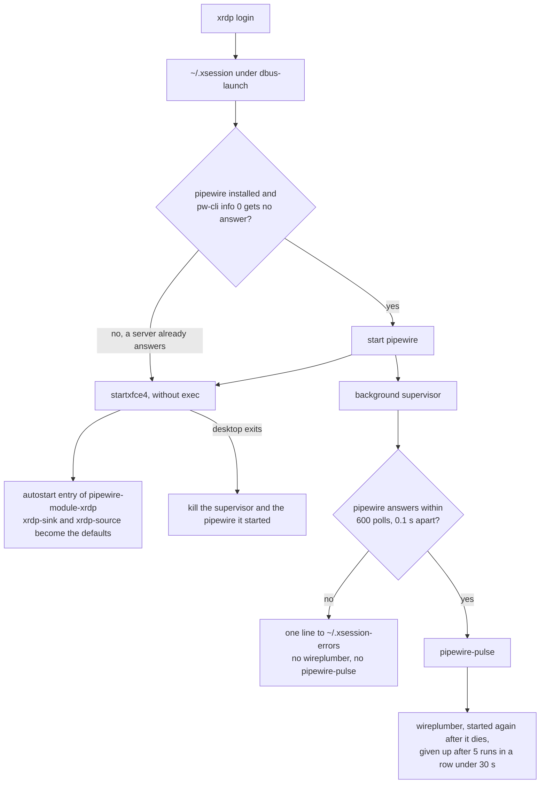

# Tech

The stack, the constraints on it, the options that were rejected, and the lookup tables of what each piece declares. [architecture.md](architecture.md) shows how the pieces fit together, [problems.md](problems.md) lists the pitfalls, and [directory.md](directory.md) says where each file lives.

## Stack

| Layer | Choice | Constraint that decided it |
| --- | --- | --- |
| Operating system | Ubuntu 26.04 on amd64 and arm64 | Nothing else is a target. A Mac appears only as the host of Docker, act and the VM tools. |
| Machine state | [mise](https://mise.jdx.dev): `mise bootstrap`, `mise dot`, shims and tasks, from `min_version = "2026.10.23"` | `[bootstrap]` and the dotfile groups exist only in recent releases. The repository is the global mise config. |
| Command line | `djd`, a wrapper over mise tasks written in bash | It forces `LC_ALL=C.UTF-8` and unsets a `MISE_ENV` of your own. |
| Scripts | bash, checked by shellcheck and `shfmt -i 4`; zsh files checked with `zsh -n` | Every file with a `sh` or `bash` shebang is linted. |
| Shell | zsh as the login shell, bash kept working; plugins by sheldon, shortcuts by zsh-abbr, prompt by starship | `.profile` stays POSIX and starts no program. |
| Desktop | XFCE over xrdp (TLS only, no root login), PipeWire audio, fcitx5 with Mozc | Part of the base, so every machine and the image get it. |
| Containers | One Docker image from `ubuntu:26.04`, built by one Dockerfile and compose | No systemd inside; the desktop entrypoint starts xrdp. |
| VMs | cloud-init (`cloud-init/vm.yaml`) on multipass or incus | The same user `dayjobdoor` and hostname `vm` as the image. |
| Secrets | age ciphertext in the mise `[env]` table of the `secrets` module | Only ciphertext reaches the repository. |
| Agents | pi and omp, with node, bun, python and uv, in the `agent` module | Their config lives under `home/.config/{pi,omp}`. |
| CI | GitHub Actions, run locally with act; images go to GHCR | Every job runs the mise task that you run locally. |

## Constraints

- Tools track `latest` behind `minimum_release_age = "3d"`; only `pi` and `omp` are exempt. GitHub Actions are pinned to commits and move through Dependabot after a seven-day cooldown.
- The system locale stays `C.UTF-8`; only the RDP session is Japanese.
- No committed secrets: [SECURITY.md](../SECURITY.md) is binding, and `.gitignore` carries the paths it names.
- No desktop app installs through `curl | sh`; each is an apt package or a release with a checksum or an attestation.
- A repository task never installs or applies anything on the host that runs it; tests do that in Docker or a VM.

## Rejected options

Each row is something that was tried or weighed and left out, with the reason that still holds. The facts behind a row live in the section it links to.

| Option | Why not |
| --- | --- |
| chezmoi, Ansible or Stow next to mise | One tool is enough: `mise bootstrap` covers packages, files, firewall, dotfiles, login shell and tools, and the repository is the global mise config ([architecture.md](architecture.md#the-checkout-is-the-global-mise-config)). |
| `mise bootstrap --from <url> --from-dir ~/.dotfiles` instead of the hand-made clone in `install.sh` | It bootstraps before `djd module add` has written the module selection, and a checkout that you use in place needs a symlink, not a clone. |
| Native `[bootstrap.users]` and `[bootstrap.groups]` for the docker group | They need a fixed user name, while the install runs as whoever calls it, so `hooks/server-post-packages` stays. |
| `[bootstrap.repos]` for the zsh plugins | It clones no submodules, so zsh-abbr (which needs zsh-job-queue) failed to initialize. sheldon checks submodules out at the commit a plugin pins. |
| `github:` tools for the pinned desktop apps | They would depend on the GitHub API (60 requests an hour anonymously), and the newest Obsidian release can be mobile-only. The `http:` tools are pinned to a version and a SHA-256 per platform. |
| A seccomp profile that allows user namespaces, instead of `--no-sandbox` in the image | It applies only to containers started with it, so `docker run` of the published image would still abort. The repository ships none, and no one has run Brave under one ([problems.md](problems.md#brave-in-a-container-runs-without-its-sandbox)). |
| `security_layer=hybrid` or NLA for xrdp | This xrdp has no NLA, and `hybrid` is not a valid value; it falls back to `negotiate` and re-enables the legacy RDP layer. |
| A global lockfile for machine tools | The Docker image digest is the reproducible artifact; the plan is in [ROADMAP.md](../ROADMAP.md). |
| `APT::Install-Recommends "false"` | Another 0.46 GB, but 359 packages go ([below](#apt-recommends-stay-on)). |

### Apt Recommends stay on

Dropping the Recommends of the apt packages (`APT::Install-Recommends "false"`) was tried and gives another 0.46 GB, but it removes 359 packages, among them the fcitx5 GTK and Qt frontends that Japanese input needs, `dbus-user-session`, the icon theme and the AT-SPI bridge, so the repository keeps the Recommends.

### Secret features of mise that were rejected

mise has four secret features, and this repository uses one of them.

| mise feature | Fits here? |
| --- | --- |
| `[dotfiles]` `encrypt = true` | No. It works only with `mode = "track"`, which uses the history repository of mise. This repository deploys with symlinks. |
| `[dotfiles]` `mode = "fnox"` | No. [fnox](https://fnox.jdx.dev) is a separate tool. It keeps the encrypted file in its own global config on each machine, and `mise dot apply` writes the file into place. Nothing reaches the repository. |
| `[env]` age values, experimental | Yes. The `secrets` module uses it, and that module is the only one that sets `experimental = true`. |
| `[bootstrap.secrets]` | No. It supplies secret inputs to bootstrap templates from environment variables. |

## Modules

A module is the file `mise-config/config.<module>.toml`. `djd module add` and `djd module remove` write the selection to `~/.config/mise/miserc.local.toml` as `env = [...]`, in the order `agent server full secrets`.

| Module | apt packages | mise tools | Runs in |
| --- | --- | --- | --- |
| base, from `config.toml` | `ca-certificates curl git zsh sudo locales tzdata less vim unzip tree sqlite3 openssh-client gnupg fastfetch make`, and for the desktop `xfce4 xfce4-terminal xfce4-screenshooter xfce4-taskmanager xfce4-clipman-plugin xfce4-xkb-plugin xrdp xorgxrdp pipewire pipewire-pulse wireplumber pipewire-module-xrdp pulseaudio-utils dbus-x11 fcitx5-mozc language-pack-ja language-pack-ja-base manpages-ja fonts-noto-cjk fonts-noto-color-emoji ghostty brave-browser libasound2t64 mesa-vulkan-drivers xsel xdotool wireshark apparmor libinput-tools libnss3 libgbm1 libcups2t64 libatk-bridge2.0-0t64 libatspi2.0-0t64 libxkbcommon0 libxss1 libxtst6 libsecret-1-0 libnotify4` | `usage starship zoxide fzf ripgrep fd bat lsd sd jq yq delta gh lazygit jj jj-starship bottom micro herdr shellcheck shfmt`, and `zed` and `zen` from GitHub releases; `hackgen`, the HackGen NF font, `obsidian`, `vicinae` and `ferdium`, from pinned `http:` URLs; `ruby` and the gem `fusuma` | every machine, the Docker image included |
| `agent` | `build-essential pkg-config libssl-dev` | `node` at the lts channel, `bun`, `python`, `uv`, `pi`, `omp`, `skills` | the Docker image, machines for agents |
| `server` | `openssh-server avahi-daemon ufw docker.io docker-compose-v2 docker-buildx` | `lazydocker` | VMs |
| `full`, which requires `agent` | 33 packages, counted in the section below | 181 tools | opt-in, and the weekly CI |
| `secrets` | none | none | machines you own, never sandboxes |

What each module declares besides packages and tools, by `mise bootstrap` part:

| Module | `files` | `services` and `firewall` | `repos` | Dotfile group | Login shell | Hooks | `[env]` |
| --- | --- | --- | --- | --- | --- | --- | --- |
| base | `/etc/locale.conf` with `C.UTF-8`, `90djd-conffiles` (`pre-packages`), `djd-electron` (an AppArmor profile) | | | `home` | `zsh` | `pre-user`, `pre-dotfiles`, `final` | `ZED_UPDATE_EXPLANATION` |
| `agent` | | | | | | | npm and bun locations, `PI_TELEMETRY`, `DO_NOT_TRACK`, `PI_CODING_AGENT_DIR`, `OMP_PROFILE`, `PI_CONFIG_DIR`, `PI_NATIVES_DIR` |
| `server` | `10-djd.conf`, `daemon.json` | docker restarts when `daemon.json` changes, ufw rules | | | | `post-packages`, `pre-dotfiles` | |
| `full` | | | | | | | |
| `secrets` | | | | | | | age ciphertext values, none committed today |

`full` declares only packages, tools, and the cargo and rust `[settings]`. `secrets` sets `experimental`, `age.key_file`, and `age.strict` in `[settings]`. The base also declares the apt source of Brave under `[bootstrap.apt.sources.brave-browser]`.

### Files that modules manage

Base:

- The dotfile group `home`.
- The login shell `zsh`.
- `/etc/locale.conf` set to `C.UTF-8`.
- Eight zsh plugins, named in `home/.config/sheldon/plugins.toml` and pinned to a commit each with `rev`: zsh-defer, zsh-completions, fast-syntax-highlighting, zsh-autosuggestions, zsh-autopair, zsh-abbr, forgit and git-open. sheldon, a base tool, checks them out under `~/.local/share/sheldon/repos` and writes `plugins.lock` beside them; `hooks/sheldon-lock` runs `sheldon lock` in the `final` hook, and the Dockerfile runs it after its dotfiles pass. zsh-abbr's submodule zsh-job-queue comes with it. To update a plugin, set a newer `rev` and run `djd apply`. The abbreviations are `home/.config/zsh-abbr/user-abbreviations`, and the aliases that replace a command are `[shell_alias]` entries of `config.toml`.

`agent`:

- `~/.config/pi/agent` and `~/.config/omp/profiles/god/agent`, from `home/.config/pi/` and `home/.config/omp/`: the settings, instructions, extensions and skills of pi and omp. The `agent` module points both tools there with `PI_CODING_AGENT_DIR` and `OMP_PROFILE`.
- `[env]` values that every program started through a mise shim sees, in any shell type: the npm and bun locations, `PI_TELEMETRY=0`, and `DO_NOT_TRACK=1`. `sh -c`, `bash -lc`, and `zsh -lc` do not see them, because none of them is a shim. `echo $DO_NOT_TRACK` in `zsh -lc` prints nothing.
- `[env]` wins over `profile.local` for the tools that mise shims start. With `export DO_NOT_TRACK=0` in `~/.config/djd/profile.local`, `zsh -lc` prints `0` and a shimmed tool still sees `1`. The same key in `~/.config/mise/config.local.toml` overrides it.
- `pi` and `omp` are the exception to `minimum_release_age = "3d"` (`minimum_release_age_excludes` in `config.agent.toml`): they install on the day they release, because they release often and the owner wants each release at once.

`server`:

- The sshd drop-in `/etc/ssh/sshd_config.d/10-djd.conf` allows keys only and denies root login. The `pre-dotfiles` hook `hooks/server-pre-dotfiles` checks it.
- ufw denies incoming traffic, limits 22/tcp, and allows 3389/tcp from private networks only. No mDNS rule exists, because `before.rules` of ufw already accepts multicast.
- `/etc/docker/daemon.json` binds published ports to `127.0.0.1` by default, through `ip` and `default-network-opts`. docker restarts when the file changes.
- The `post-packages` hook refuses the apply before the drop-in is written when it runs as root, when the user has no authorized key, or when sshd listens on a port other than 22: each would lock the user out once passwords and root login are off and the firewall allows port 22 only. It adds the user to the `docker` group only after those checks. `DJD_SKIP_SSH_CHECKS=1` skips the refusals.
- `djd module remove server` deletes the sshd drop-in and `daemon.json`, so password logins and published ports on every address return. It leaves the packages and the ufw rules, so SSH stays reachable, and it prints a warning.

The desktop, which is part of the base:

- The desktop session is Japanese: `~/.xsession` exports `LANG=ja_JP.UTF-8`, and `language-pack-ja-base` generates that locale. `/etc/locale.conf` stays `C.UTF-8`, as the Docker image's `LANG` does, so agents and ssh logins stay English.
- `home/.xsession`, with the fcitx5, ghostty, zed, fusuma and wireshark configs under `home/.config/`. `~/.xsession` starts the audio daemons for the session, as the diagram below shows.
- Audio over RDP comes from the package `pipewire-module-xrdp`. An XDG autostart entry of that package loads `xrdp-sink` and `xrdp-source` into the session's PipeWire and makes them the defaults through `pactl`, from `pulseaudio-utils`.
- The four required apps. `ghostty` comes from the Ubuntu archive. `brave-browser` comes from Brave's apt repository, declared in `[bootstrap.apt.sources.brave-browser]` with `suites = "stable"` and three pinned key fingerprints. `zed` and `zen` are `github:` tools at `latest`, with a per-platform `asset_pattern`. [architecture.md](architecture.md#the-desktop-apps-each-carry-a-trust-anchor) explains what verifies each one.
- The extra apps. `wireshark` comes from the Ubuntu archive, and `hooks/desktop-final` answers its debconf question so that `dumpcap` captures for the group `wireshark`, which the user joins (log in again). `obsidian`, `vicinae` and `ferdium` are `http:` tools pinned to a version and a SHA-256 per platform; their postinstalls link one program into the tool's `bin/` and write a menu entry and an icon. Obsidian and Ferdium are Electron apps: `/etc/apparmor.d/djd-electron` lets those two programs use user namespaces, so their Chromium sandbox works under Ubuntu's AppArmor restriction (`hooks/desktop-final` loads it where AppArmor runs; the Docker image has none, so it adds `--no-sandbox` to their entries, as it does for Brave). The `fusuma` gem needs `libinput-tools` and the group `input`; `home/.config/fusuma/config.yml` is its gesture map, started with `fusuma -d`. `home/.config/wireshark/language` sets the Wireshark interface to Japanese.
- Each app has an XFCE menu entry. Brave and ghostty use the entries of their packages. The `postinstall` of `zed` and `zen` writes `~/.local/share/applications/dev.zed.Zed.desktop` and `zen.desktop` with `Exec` on the mise shim, and installs the icon. `filter_bins = "zen"` keeps `zen-bin`, `updater`, `pingsender`, and `gfxtest` off `PATH`.
- The `postinstall` of `zen` also writes `distribution/policies.json` with `DisableAppUpdate` and `DisableTelemetry`, and the module's `[env]` sets `ZED_UPDATE_EXPLANATION` for Zed, so neither app replaces files in the mise install directory ([architecture.md](architecture.md) and [SECURITY.md](../SECURITY.md) give the reasons).
- The Docker image, not the base config, writes a user-level `~/.local/share/applications/brave-browser.desktop` that adds `--no-sandbox` to every `Exec` line.
- `tests/desktop-apps.sh` checks all four apps, and that the extra apps are on `PATH` with a working menu entry. `.mise/tasks/test/desktop` runs it in the image with `DJD_APPS_LAUNCH=1`, which also starts Brave and Zen headless and opens a new window for ghostty and Zed inside the RDP session, and `tests/vm-checks.sh` runs it in the VM without the variable.
- HackGen NF is the `http:hackgen` tool, pinned to a version and a SHA-256. Its `postinstall` copies the four `.ttf` files to `~/.local/share/fonts/HackGen` and runs `fc-cache -f`, and the install fails without `fc-cache`. The image has none, and the base declares no `fontconfig` package, so it relies on a dependency of the desktop packages (inference, not checked). `hooks/desktop-final` makes no download, and no `.version` stamp file exists any more.
- The `final` hook purges light-locker, xscreensaver, im-config, and the pulseaudio daemon, which would claim the pulse socket next to pipewire-pulse. It sets `security_layer=tls` in `/etc/xrdp/xrdp.ini` and `AllowRootLogin=false` in `/etc/xrdp/sesman.ini`, and it restarts a running xrdp once per change, because the daemon keeps the values it started with (with an RDP session open it prints the restart command instead, and the next apply tries again; `djd doctor` reads the files, and `tests/vm-checks.sh` compares the daemon's start time). Never write `security_layer=hybrid` there. See [RDP security](problems.md#rdp-security-and-known-limits).
- `/etc/apt/apt.conf.d/90djd-conffiles` sets `--force-confdef` and `--force-confold` for every apt run on the machine, so `djd update` keeps the edited xrdp conffiles and never stops at dpkg's conffile prompt. A new maintainer version lands beside the file as `*.dpkg-dist`.
- The dotfile `home/.config/zed/settings.json` turns Zed's telemetry and auto-update off. Zed may rewrite the file through its symlink.

How `~/.xsession` starts audio, read from `home/.xsession`:



- The desktop does not wait for the audio daemons. The supervisor polls first because wireplumber exits when it starts before the server answers.
- `pw-cli` is asked, and the socket file is not tested. A socket file that a dead server left behind does not count, and a server that already answers is never touched or killed. In a VM, systemd's socket-activated server should answer the check, so that nothing starts twice. That case was not tested in a VM.
- The supervisor ends its own wireplumber and pipewire-pulse when it gets TERM. Logging out would otherwise leave the daemons running, and the supervisor would start a wireplumber against the dead session bus. A session that only disconnects keeps running and loses nothing.
- Two limits remain. `pipewire-module-xrdp` loads its module from a background `pw-cli`, so each login leaves one idle `pw-cli` behind. Nothing restarts `pipewire-pulse` or the pipewire server when either dies, and a `wireplumber` that dies five times in a row within 30 s of starting stays off until the next login.

`secrets`: `[env]` values stored as age ciphertext.

### Size of the full module

The `full` module has 33 apt packages. 21 are CLI packages, such as build libraries and network tools. 12 are GUI libraries and programs that no longer wait for a desktop selection, because the desktop is part of the base. They are GTK and WebKit development libraries, flatpak, and a terminal music stack (`mpd`, `mpc`, `ncmpcpp`). ruby comes from mise only, and sqlite3 and fastfetch come from the base apt list. dotnet is commented out because its installer rejects 26.04, and vegeta and taskctl install on amd64 only.

These commands regenerate the counts. They print 181 tools and 33 apt packages.

```sh
awk '/^\[tools\]/{t=1;next} /^\[/{t=0} t&&/^"?[a-z]/' mise-config/config.full.toml | wc -l
awk '/^\[bootstrap.packages\]/{p=1;next} /^\[/{p=0} p&&/^"apt:/' mise-config/config.full.toml | wc -l
```

Plan for at least 10 GB of free disk. That figure is an estimate. One install of 155 of the 181 tools used 7.5 GB of installs plus 2.5 GB of cache. It was measured once, in October 2026, on an arm64 Mac running OrbStack. The other 26 tools were not measured.

## djd commands

`home/.local/bin/herdr-dev` starts herdr with the dev preset (see `~/.config/zsh/.zprofile` below), and `home/.local/bin/x` prints an ASCII-art picture. `home/.local/bin/djd` routes `djd <cmd> [args]` to `mise run djd:<cmd> [args]`. It runs from `$HOME` with `MISE_TASK_RUN_AUTO_INSTALL=false` and `LC_ALL=C.UTF-8`. Plain `djd` lists the commands. `install.sh` ends by running this wrapper, so it gets the same environment.

| Command | Does |
| --- | --- |
| `djd apply [flags]` | Runs `mise bootstrap --yes --update`, clears the shell init caches, and runs `mise cache prune`, which deletes the archives that mise downloaded more than `cache_prune_age` (one day) ago. It moves no file itself. Real files that a dotfile would replace are moved aside by the `pre-dotfiles` hook (see Bootstrap phases and hooks). |
| `djd update` | Runs `git fetch` and `git merge --ff-only @{u}`, then `mise self-update`, then `djd apply --upgrade`. It prints a message and skips the pull when `~/.dotfiles` is not a git checkout, when no branch is checked out (a detached HEAD, which a jj colocated checkout always has), or when the branch has no upstream. A dirty file that the update does not touch stays. |
| `djd status` | Prints the checkout path and commit, the selected modules, and `mise bootstrap status`. |
| `djd doctor` | Checks Ubuntu 26.04 (`VERSION_ID`), the `~/.config/mise` link, the zsh login shell, `bootstrap status --missing`, the sheldon lock (it has to exist, be newer than `plugins.toml`, and name directories that are there), and `dot status --missing`, and lists each dotfile that differs from the checkout. Hooks are imperative and `bootstrap status` cannot see what they enforce, so it also checks them. With `server` selected, it checks that sshd is keys-only through `hooks/sshd-keys-only`, which evaluates `sshd -T -C` for the current user whenever a `Match` line exists. It always checks `security_layer=tls` in `xrdp.ini` and `AllowRootLogin=false` in `sesman.ini`, each on its own line, because every machine has xrdp. With the `secrets` module selected, it also checks that `~/.config/djd/age.txt` exists, has no group or other permission bits (mode 0600 and 0400 pass), and decrypts every value. Exits with code 1 on any failure. |
| `djd module list` | Prints each module and whether it is selected. It rejects module names (exit 2). |
| `djd module add <module>...` | Selects the modules (a missing or unknown name exits 2 with a message) and applies the selection. `full` selects `agent` too. Prints a warning when `server` is not selected, because every machine runs xrdp and only `server` carries the RDP firewall rules. |
| `djd module remove <module>...` | Unselects the modules, unapplies their files, and applies what remains. A module that was never applied causes no error. It refuses to remove `agent` while `full` is selected (exit 2). The packages stay. |
| `djd secret keygen` | Creates the age key at `~/.config/djd/age.txt`. |
| `djd secret set <name>` | Encrypts a prompted value into the secrets module. The task is `raw=true` ([architecture.md](architecture.md#secrets-use-the-age-support-of-mise) says why). |

Only `djd module` and `djd secret` declare arguments, so only their `--help` lists them. `djd apply`, `djd update`, and `djd status` pass extra flags to the mise command they run, as in `djd apply --upgrade`. `djd doctor` ignores them. The `djd` wrapper unsets your own `MISE_ENV`, which would otherwise replace the module selection, and `install.sh` inherits that through the wrapper.

## Make targets

`make <task>` runs `mise run <task>`, and `make <task> ARGS=<args>` passes arguments. `make build ARGS=full` runs `mise run build full`. `make` hands `ARGS` to the recipe as an environment variable, and the shell splits it into words. It never reads `ARGS` as shell syntax, so `ARGS='x; cmd'` passes the two words `x;` and `cmd`. `make help` lists the tasks. Two groups differ.

- `make init` runs `./install.sh $(ARGS)`. It runs before mise exists, so the machine needs make. A fresh Ubuntu cloud image can lack it, and `sudo apt-get install make` adds it. `./install.sh` needs no make, and the base apt list installs make for later runs.
- `make apply`, `make update`, `make status`, `make doctor`, `make module`, and `make secret` run `djd`, so they keep its locale and its working directory.

## Bootstrap phases and hooks

`mise bootstrap --help` documents the order (the `min_version` in `mise-config/config.toml` is the release that this repository follows). It applies the parts that the config declares in this order, and the `--only` and `--skip` flags take the part names. The table lists only the parts that this repository uses, with the hooks that run around them. It leaves out `accounts`, `plugins`, `compose`, the shell-activation, macOS and systemd-unit parts, and the `bootstrap` task, because the repository declares none of them. The row numbers are this table's own order, not mise's step numbers.

| # | Part | Hook around it | Declared by | The hook does |
| --- | --- | --- | --- | --- |
| 1 | `files` with `phase = "pre-packages"` | | | |
| 2 | `packages` | `post-packages`, right after | `server` | Runs `hooks/server-post-packages`. It refuses the apply, before step 3 writes the sshd drop-in, when the apply runs as root, when `~/.ssh/authorized_keys` (or `authorized_keys2`) holds no key, or when sshd listens on a port other than 22. Only after those checks does it add the user to the `docker` group. `DJD_SKIP_SSH_CHECKS=1` skips the refusals, and the hook still adds the user to the group. |
| 3 | the other `files`, then `services`, then `firewall` | | | |
| 4 | `repos` | | | |
| 5 | `dotfiles` | `pre-dotfiles`, before | base | Run `hooks/dotfile-conflicts <group>` for the dotfile group `home`. It deletes a real file that equals its `/etc/skel` copy, and moves any other real file that a dotfile would replace to `<file>.djd-backup-<epoch>-<pid>`, where `<epoch>` is the time in seconds and `<pid>` is the process ID of the hook. |
| 5 | `dotfiles` | `pre-dotfiles`, before | `server` | Runs `hooks/server-pre-dotfiles`, which fails the apply unless the sshd drop-in is in effect (`hooks/sshd-keys-only` makes the check, and `djd doctor` shares it). It runs after the base and `agent` hooks, so an apply that fails here can leave files moved aside. |
| 6 | `user` (the login shell) | `pre-user`, before | base | Switches the login shell to zsh through sudo. |
| 7 | `tools` | | | |
| 8 | `final-hook` | `final` | base | Runs `hooks/desktop-final`, then `hooks/sheldon-lock` (`sheldon lock`, which fetches the zsh plugins at their pinned `rev`; it does nothing where sheldon is not installed yet). It purges the packages that break xrdp sessions (it waits up to 120 s for the dpkg lock), sets up the groups and the AppArmor profile of the desktop apps, makes xrdp TLS-only without root logins, and restarts a running xrdp once per change (not while an RDP session is open, when it says so and the next apply tries again). |

A standalone `mise dot apply` also runs the `pre-dotfiles` and `post-dotfiles` hooks. mise runs the hooks of every selected module in order, base first, and only when their part runs, so `djd apply --dry-run`, `--skip dotfiles`, and `--only` without `dotfiles` move no file. mise runs hooks and the `bootstrap` task on every run, so a hook must be safe to repeat. [architecture.md](architecture.md#hooks-live-in-the-module-that-needs-them) gives the reasons for each hook.

The sshd check of `hooks/sshd-keys-only` covers the effective settings of the current user, not every possible login. [architecture.md](architecture.md#a-module-is-a-mise-config-environment) gives its scope.

## Shell startup files

| File | Read by | Does |
| --- | --- | --- |
| `~/.profile` | bash login shells and zsh through `.zshenv` | Sets the XDG directories, `DJD_DIR`, `PATH` with the mise shims and `~/.local/bin`, `LANG`, `TZ` with the default `Asia/Tokyo`, `EDITOR`, and the history files `PYTHON_HISTORY` and `NODE_REPL_HISTORY`. less keeps its history under the XDG state directory by its own rule, so `.profile` does not set `LESSHISTFILE`. Then reads `~/.config/djd/profile.local`. It is POSIX and has no side effects. |
| `~/.zshenv` | every zsh | Sets `skip_global_compinit=1`, so that the `compinit` of `/etc/zsh/zshrc` does not drop `.zcompdump` into `ZDOTDIR`. Sets `ZDOTDIR=~/.config/zsh` and sources `.profile`. |
| `~/.config/zsh/.zshenv` | every zsh that starts with `ZDOTDIR` already exported, which is a nested shell | Sources `~/.zshenv`, so nested shells load `.profile` too. |
| `~/.config/zsh/.zprofile` | zsh login shells | Starts herdr on a real terminal, through `herdr-dev` (`~/.local/bin/herdr-dev`), which first ensures the dev preset tabs: 101 (`btm`), 102 (`fastfetch`), Dev, Docs (when `pi` is installed) and lazydocker (when docker answers). `HERDR_DEV_CWD` (default `~/.dotfiles`) and `HERDR_DEV_DATA` set where the preset starts and looks for `cat.txt`. It does not start herdr when `DJD_NO_MUX` is set, as the Docker images do, nor inside herdr, nor in an IDE terminal, nor for `zsh -lic cmd`. |
| `~/.config/zsh/.zshrc` | interactive zsh | Sets up history, completion (a dump younger than a day is reused with `compinit -C`), `mise activate` first, so that the tool inits after it find the installed binaries and not the shims, then the zsh plugins through `sheldon source` (before compinit, so zsh-completions' fpath is indexed), then starship, zoxide, fzf, atuin when installed (after fzf, so atuin owns Ctrl-R), and reads `$ZDOTDIR/.zshrc.local`. The cached tool inits are keyed by the tool, its resolved binary path, and a checksum of the init command line, so an upgrade or an edited argument regenerates them. It exports `DJD_ARCH=x86_64` on x86_64, for the arch badge of starship. Without sheldon or its lock it loads no plugin and prints nothing. Its `chpwd` hook runs `ls -la` in the top-level shell only. |
| `~/.config/zsh/.zlogin` | zsh login shells | Prints an interactive banner with fortune and cowsay, when installed. Prints a second banner with figlet and lolcat, when installed. A login shell that runs a command (`zsh -lc`, `zsh -lic`) prints nothing. |
| `~/.config/zsh/.zlogout` | interactive zsh login shells, on exit | Runs fastfetch, or prints a short banner when it is missing. `zsh -lc` does not read it, and `zsh -lic cmd` reads it but prints nothing. |
| `~/.bash_profile` and `~/.bashrc` | bash | Source `.profile`, then run the interactive-only setup: history (appended, not overwritten), starship, zoxide, omp completions, and `mise activate` before them, so that the cached inits are keyed by the installed binary's path. starship's init keeps the `PROMPT_COMMAND` it finds, so mise's hook survives. `.bashrc` exports `DJD_ARCH` like `.zshrc`. |

## Environment variables

The tables group the variables by where they matter. The scope names are install (`install.sh` and the djd tasks), login (login shells and anything that sources `.profile`), shim (a program started through a mise shim), image (the Docker image environment), build (a Docker build), tasks (the repo tasks), and compose (`.devcontainer/compose.yaml`).

### Install and djd

| Variable | Scope | Default | Effect |
| --- | --- | --- | --- |
| `DJD_DIR` | login | `~/.dotfiles` | Path of the checkout, which `.profile` always exports as `$HOME/.dotfiles`. It is not an override: `install.sh` and the djd tasks always use `~/.dotfiles`, because mise reads `~/.config/mise` and `dotfiles.root` there. |
| `DJD_REPO` | install | the GitHub URL of this repository | Repository that `install.sh` clones. |
| `DJD_SKIP_SSH_CHECKS` | install, tasks | unset | When non-empty, the server module's `post-packages` hook skips its refusals (no authorized key, root, a port other than 22). For a machine that is reached through a console, `incus exec` or `multipass exec`. `test:vm` sets it. |
| `MISE_VERSION` | install | the `min_version` of `mise-config/config.toml`, with a `v` prefix | mise release that `install.sh` installs when mise is missing or older than `min_version`. A value in the environment overrides the release to install, with or without the `v`. Without a `min_version`, `install.sh` stops. |
| `DJD_BOOTSTRAP_FLAGS` | install | empty | Extra flags that `djd apply` passes to `mise bootstrap`. The Docker build passes `--skip tools,dotfiles`, `--only tools`, and `--only dotfiles`. |
| `MISE_ENV` | install, shim | unset | The module selection, which mise reads from `miserc.local.toml`. The `djd` wrapper, and so `install.sh`, and `djd module` unset a value of your own. A shimmed process passes it to its children, where it outranks a project's `.miserc.toml` (see [the module selection](problems.md#a-project-that-selects-its-own-mise-environment-hides-the-modules)). |
| `LC_ALL` | install | `C.UTF-8` | The `djd` wrapper forces it, because mise matches the English ufw output. `tests/vm-checks.sh` sets it too. |

### Login shells

| Variable | Scope | Default | Effect |
| --- | --- | --- | --- |
| `LANG` | login, image | `C.UTF-8` | `.profile` keeps a value that is already set. The images set `LANG=C.UTF-8` themselves, because `docker run` and `docker exec` read no `.profile`. `/etc/locale.conf` sets the system locale to `C.UTF-8` too; only the desktop session switches to `ja_JP.UTF-8`. |
| `TZ` | login | `Asia/Tokyo` | Time zone of login shells. `.profile` keeps a value that is already set. `docker exec` and shims do not read it, so a plain `docker run` of the image reports `UTC`. |
| `DJD_NO_MUX` | login, image | unset | When non-empty, `.zprofile` does not start herdr. The Docker images set it. |
| `DJD_ARCH` | interactive shell | unset | `.zshrc` and `.bashrc` set it to `x86_64` on x86_64 hosts. The `env_var.DJD_ARCH` module of `starship.toml` shows it as the arch badge. |

### Tokens

| Variable | Scope | Default | Effect |
| --- | --- | --- | --- |
| `GITHUB_TOKEN` | tasks, CI | none | A token without scopes, which only lifts the anonymous GitHub rate limit. `mise run build` and `mise run ci` stop when it is unset, and `test` and `test:desktop` build first, so they stop too. An empty `GITHUB_TOKEN=` runs anonymously. Never use `gh auth token`, which carries every scope of your login. `test:vm` hands it to mise in the VM when it is set. Builds pass it to Docker as a BuildKit secret. |
| `MISE_GITHUB_TOKEN` | build, install | none | The name that mise reads. The Dockerfile mounts the secret under it in the second `RUN`, `test` and `full-weekly.yaml` set it from `GITHUB_TOKEN`, and a curl install can pass it. The narrower name keeps gh and other tools from picking the token up inside the build. |

### Docker build and tests

| Variable | Scope | Default | Effect |
| --- | --- | --- | --- |
| `DJD_MODULES` | build | `agent` | Build argument of the Dockerfile. It lists the modules that a flavor installs. |
| `DJD_REVISION` | build, image | `unknown` | Build argument of the Dockerfile. `mise run build` sets it from `git describe --always --dirty` (a build from a modified tree ends in `-dirty`, and it is `unknown` without git), `push.yaml` sets the full commit SHA, and the builds of `compose.yaml` and `devcontainer.json` leave it unset. `djd status` prints it when the checkout has no `.git`. |
| `DJD_KEEP_VM` | tasks | unset | When exactly `1`, `test:vm` keeps its VM after the run. Any other value deletes it. |
| `DJD_APPS_LAUNCH` | tasks | unset | When `1`, `tests/desktop-apps.sh` also starts the four apps. `test:desktop` sets it. |
| `DJD_TEST_VM` | tasks | unset | `tests/vm-checks.sh` refuses to run unless this is `1` and exits 2. Only `test:vm` sets it, inside the VM. The script changes the machine it runs on. |

### Compose

| Variable | Scope | Default | Effect |
| --- | --- | --- | --- |
| `RDP_PORT` | compose | `33389` | Host port that `compose.yaml` publishes on `127.0.0.1` for RDP. Set it in `.devcontainer/.env`. |
| `PASSWORD` | compose | required | RDP password of the desktop container. Set it in `.devcontainer/.env`. It must not contain a newline: the entrypoint exits 2 for one, because `chpasswd` reads one `user:password` pair per line. |
| `TUNNEL_TOKEN` | compose | none | Token of the optional cloudflared service, which is commented out in `compose.yaml`. When you enable it, the token goes in `environment` and not on the command line. |

A value that you export in your shell wins over `.devcontainer/.env` for `RDP_PORT` and `PASSWORD`. `PASSWORD` feeds the `djd_rdp_password` secret, which `docker compose config` does not render, so this was checked by reading `/run/secrets/djd_rdp_password` in a throwaway compose project whose `.env` held another value: the exported value was the one in the file. These names are generic, so a stray export silently becomes the RDP password or port. `PASSWORD` and `TUNNEL_TOKEN` are secrets.

Precedence in login shells and tools:

1. `.profile` keeps a value that is already set for the XDG variables, `LANG`, `TZ`, and `EDITOR`. It always sets `DJD_DIR`, `PYTHON_HISTORY`, and `NODE_REPL_HISTORY`. It reads `profile.local` last, so a value there wins in login shells.
2. The `[env]` table of a module reaches programs that start through a mise shim and interactive shells with `mise activate`. It does not reach `sh -c`, `bash -lc`, or `zsh -lc`.
3. For a shimmed program, `[env]` wins over `profile.local`. To override an `[env]` key there, set it in `~/.config/mise/config.local.toml`.

[SECURITY.md](../SECURITY.md#local-overrides) lists the machine-local override files.

## Docker images

[architecture.md](architecture.md#docker-images-are-one-dockerfile-in-two-passes) explains how the Dockerfile builds them.

| Image | Modules | Use |
| --- | --- | --- |
| `ghcr.io/dayjobdoor/dotfiles:latest`, also tagged `X.Y.Z` and `X.Y` | `agent` on the base, which includes the desktop | Agent sandbox, devcontainer and XFCE over RDP. `.devcontainer/compose.yaml` builds the same image locally and publishes RDP on `127.0.0.1:33389`. `mise run up` starts it. |
| `djd:full`, local only and not published | `agent` and `full` | The full toolbox. `mise run build full` builds it. `full-weekly.yaml` builds it weekly, runs `djd doctor` in it, and then runs `djd update && djd doctor`. |

Every image sets `DJD_NO_MUX=1`, `DEBIAN_FRONTEND=noninteractive`, and `LANG=C.UTF-8`, and puts the mise shims on `PATH`. The images that `mise run build` and `push.yaml` build also carry the commit in `DJD_REVISION`. Start the containers with `--init`, so that an init process reaps zombies. `compose.yaml` and `devcontainer.json` set it, and `mise run shell` passes it.
